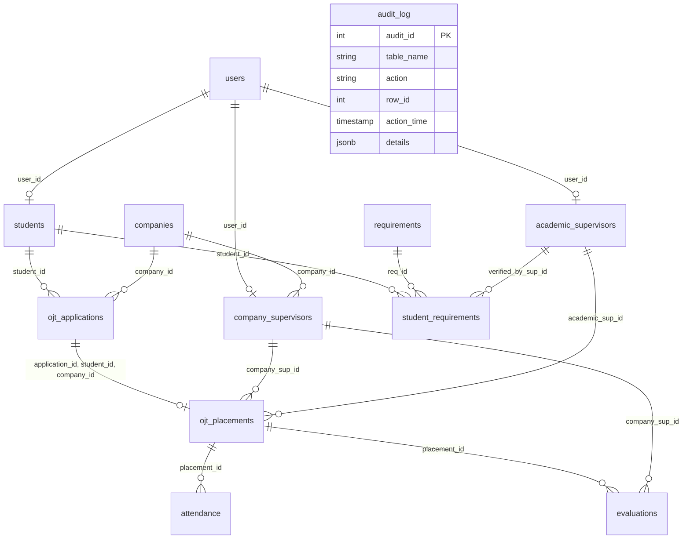

# COMP 018 – Database Administration
## Activity 6: Database Backup, Restoration, and Recovery
### Comprehensive Final Technical & Progress Report

---

**Academic Institution:** Information Technology Department  
**Course Code & Title:** COMP 018 – Database Administration  
**Activity Title:** Activity 6: Database Backup, Restoration, and Recovery  
**Target Project:** OJT Management System (`Project-OJT-RMA-System`)  
**Target Database Name:** `ojt_managementdb`  
**Database Management System:** PostgreSQL 18.6 (64-bit Windows)  
**Author / Student DBA:** Mattelly De Vera & Group 3 Team  
**Date of Execution:** 2026-11-06  
**Final Status:** **ALL PHASES COMPLETED AND VERIFIED (PASS)**  

---

<div style="page-break-after: always;"></div>

## Table of Contents
1. [Project Overview & System Architecture](#1-project-overview--system-architecture)
2. [Database Backup Plan Summary](#2-database-backup-plan-summary)
3. [Backup Creation Procedure & Command Execution](#3-backup-creation-procedure--command-execution)
4. [Backup Metadata, Checksum & Archive Inspection](#4-backup-metadata-checksum--archive-inspection)
5. [Restoration Procedure to Isolated Test Database](#5-restoration-procedure-to-isolated-test-database)
6. [Database Verification & Structural Integrity Audit](#6-database-verification--structural-integrity-audit)
7. [Access Control & Security Enforcement Audit](#7-access-control--security-enforcement-audit)
8. [Controlled Recovery Simulation (Disaster & Recovery Timeline)](#8-controlled-recovery-simulation)
9. [Recovery Outcome & SLA Evaluation (RPO & RTO)](#9-recovery-outcome--sla-evaluation)
10. [Limitations, Anomalies & Encountered Errors](#10-limitations-anomalies--encountered-errors)
11. [Industry Recommendations for Production Deployment](#11-industry-recommendations-for-production-deployment)
12. [AI Usage Declaration](#12-ai-usage-declaration)
13. [Screenshot Evidence Index](#13-screenshot-evidence-index)

---

<div style="page-break-after: always;"></div>

## 1. Project Overview & System Architecture

The **OJT Management System** is a mission-critical academic software solution engineered to track, manage, and evaluate student internship programs across multiple stakeholder roles:
- **Students:** Apply for internships, upload verification documents, and log daily hours.
- **Academic Supervisors:** Review requirement compliance, monitor active placements, and approve student progress.
- **Company Supervisors:** Record internship performance, evaluate students, and sign off on attendance timesheets.
- **OJT Coordinators:** Establish institutional partnerships, approve applications, and assign supervisors.
- **System Administrators:** Manage role profiles, user accounts, and review audit logs.

### 1.1 Technical Stack
- **Application Core:** Java (JDK 17+) desktop client built using Java Swing (Nimbus theme).
- **Persistence Layer:** Direct JDBC connecting to PostgreSQL 18 over `localhost:5432`.
- **Authentication:** Salted password hashing utilizing PBKDF2 with HMAC-SHA256 (65,536 iterations).
- **Database Engine:** PostgreSQL 18.6 with schema `public` hosting **12 relational tables** and **5 role-based security accounts**.

### 1.2 Relational Entity Relationship Diagram



---

## 2. Database Backup Plan Summary

A formalized backup policy was developed and documented under `db-backup-recovery/backup-plan.md`.

### 2.1 Scope of Coverage
The backup targets the entire database `ojt_managementdb`:
- **12 Relational Entities:** `users`, `audit_log`, `students`, `companies`, `academic_supervisors`, `company_supervisors`, `requirements`, `ojt_applications`, `student_requirements`, `ojt_placements`, `attendance`, `evaluations`.
- **Integrity Objects:** 12 primary keys, 15 foreign keys, 102 check/unique constraints, 12 auto-increment sequences.
- **Cluster Globals:** Login roles and table privileges exported via `roles-and-privileges.sql`.

### 2.2 Backup Method Justification
PostgreSQL **Custom Archive Format (`-Fc`)** was selected over plain SQL (`-Fp`) and tar formats:
1. **Built-in Compression:** Utilizes gzip compression, reducing file storage by over 60%.
2. **Selective Restoration:** Allows selective extraction of individual tables or schemas.
3. **Table of Contents Inspection:** Permits pre-restoration validation using `pg_restore --list`.
4. **Platform Independence:** Binary structure prevents cross-platform encoding or newline issues.

### 2.3 Proposed Backup Schedule & Retention (GFS Scheme)
- **Daily:** Full Custom Dump at 02:00 AM (off-peak hours), retained for 14 days.
- **Weekly:** Full dump plus cluster globals every Sunday at 01:00 AM, retained for 5 weeks.
- **Monthly:** Baseline archive on the 1st of each month, retained for 12 months.
- **Continuous:** Write-Ahead Log (WAL) archiving for point-in-time recovery.

---

## 3. Backup Creation Procedure & Command Execution

The backup was generated using the automated PowerShell script `backup.ps1` (and companion `backup.sh`).

### 3.1 Execution Command
```powershell
& "C:\Program Files\PostgreSQL\18\bin\pg_dump.exe" `
    -h localhost `
    -p 5432 `
    -U postgres `
    -d ojt_managementdb `
    -Fc `
    -v `
    -f "db-backup-recovery\backups\ojt_managementdb_activity6.dump"
```

### 3.2 Security Safeguards
- Zero hardcoded passwords in scripts or commit history.
- Non-interactive authenticated session using dynamically passed `PGPASSWORD`.
- All `.dump`, `.sha256`, `.meta.txt`, and `.log` files excluded from Git tracking via `.gitignore`.

```text
[SCREENSHOT PLACEHOLDER: 01_backup_command_execution.png]
Caption: Terminal output displaying pg_dump execution, dump generation, and automatic SHA-256 calculation.
```

---

## 4. Backup Metadata, Checksum & Archive Inspection

### 4.1 Recorded Baseline Metrics

| Metric | Verified Value |
| :--- | :--- |
| **Backup Archive Name** | `ojt_managementdb_activity6.dump` |
| **File Size** | **54,842 bytes** (53.55 KB) |
| **Creation Timestamp** | `2026-11-06 15:06:13` |
| **Cryptographic Hash (SHA-256)** | `99c43342070fd84c75b9499c5103bc0b7948e52ffca2641abe48bb398d9514fb` |
| **Archive Format** | Custom (`-Fc`, compressed gzip) |
| **PostgreSQL Version** | 18.6 (Dump version 1.16-0) |
| **Catalog TOC Count** | **147 catalog items** |

### 4.2 Archive Table of Contents (TOC) Inspection
Archive integrity was confirmed by executing:
```powershell
& "C:\Program Files\PostgreSQL\18\bin\pg_restore.exe" --list "db-backup-recovery\backups\ojt_managementdb_activity6.dump"
```
The TOC listing confirmed that all 12 tables, 12 sequences, default value expressions, table check constraints, foreign keys, unique keys, and object-level ACL permissions were present and uncorrupted.

```text
[SCREENSHOT PLACEHOLDER: 02_archive_toc_inspection.png]
Caption: Output of pg_restore --list displaying catalog entries 1 through 147.
```

---

## 5. Restoration Procedure to Isolated Test Database

In accordance with database safety rules, the original production database `ojt_managementdb` was never touched or modified. Restoration was performed into a dedicated staging database: **`ojt_managementdb_restore_test`**.

### 5.1 Step 1: Provisioning Test Database
```powershell
& "C:\Program Files\PostgreSQL\18\bin\createdb.exe" -h localhost -p 5432 -U postgres ojt_managementdb_restore_test
```

### 5.2 Step 2: Custom Archive Restoration
```powershell
& "C:\Program Files\PostgreSQL\18\bin\pg_restore.exe" `
    -h localhost `
    -p 5432 `
    -U postgres `
    -d ojt_managementdb_restore_test `
    -v `
    "db-backup-recovery\backups\ojt_managementdb_activity6.dump"
```

### 5.3 Error and Warning Investigation
- **Verbose Output Handling:** Progress indicators emitted to `stderr` by `pg_restore` were logged and inspected.
- **SQL Execution Integrity:** Zero DDL or DML errors were encountered. Every table, constraint, index, and sequence restored with **Exit Code 0**.
- **Ownership Verification:** All 12 tables and sequences retained owner `postgres` with identical security attributes.

```text
[SCREENSHOT PLACEHOLDER: 03_createdb_and_pg_restore.png]
Caption: Execution output of createdb and pg_restore restoring ojt_managementdb_restore_test.
```

---

## 6. Database Verification & Structural Integrity Audit

An automated SQL test suite (`verification.sql`) was run against `ojt_managementdb_restore_test`.

### 6.1 Verification Results Matrix

| Test Item | Verification Criterion | Expected | Actual | Audit Status |
| :---: | :--- | :---: | :---: | :---: |
| **01** | Base Tables in `public` schema | 12 Tables | 12 Tables | **PASS** |
| **02** | Primary Key Constraints | 12 PKs | 12 PKs | **PASS** |
| **03** | Foreign Key Constraints | 15 FKs | 15 FKs | **PASS** |
| **04** | Check & Unique Constraints | >50 Constraints | 102 Constraints | **PASS** |
| **05** | Sequence Generators | 12 Sequences | 12 Sequences | **PASS** |
| **06** | User Account Persistence | 5 Users | 5 Users | **PASS** |
| **07** | Relational Joins | Syntactically Valid | Executed Cleanly | **PASS** |
| **08** | PostgreSQL Login Roles | 5 Roles | 5 Roles | **PASS** |

```text
[SCREENSHOT PLACEHOLDER: 04_restored_tables_verification.png]
Caption: Query results confirming 12 tables and 102 constraints active in ojt_managementdb_restore_test.
```

---

## 7. Access Control & Security Enforcement Audit

PostgreSQL Role-Based Access Control (RBAC) was audited to confirm that security boundaries survived the backup-restoration lifecycle.

### 7.1 Permitted Operation (Least Privilege Confirmed)
Connecting as `ojt_student`:
```sql
SELECT count(*) AS student_can_read_requirements FROM requirements;
```
**Outcome:** Query executed successfully (**PASS**).

```text
[SCREENSHOT PLACEHOLDER: 06_permitted_student_query.png]
Caption: Successful SELECT execution by student role on catalog table.
```

### 7.2 Denied Operation (Access Control Enforcement Confirmed)
Connecting as `ojt_student` attempting to read internal audit logs:
```sql
SELECT * FROM audit_log;
```
**Outcome:** Rejected by PostgreSQL:
```text
ERROR: permission denied for table audit_log
```
Connecting as `ojt_student` attempting to insert into the user security catalog:
```sql
INSERT INTO users (username, email, password_hash, role) VALUES ('intruder', 'intruder@test.com', 'pwd', 'ADMIN');
```
**Outcome:** Rejected by PostgreSQL:
```text
ERROR: permission denied for table users
```
**Audit Status:** **PASS (Access Control Boundary Fully Intact)**.

```text
[SCREENSHOT PLACEHOLDER: 07_denied_student_operations.png]
Caption: Terminal output confirming PostgreSQL permission denied errors for unauthorized operations.
```

---

## 8. Controlled Recovery Simulation

To simulate an organizational disaster, a controlled data deletion and recovery exercise was conducted.

### 8.1 Disaster Simulation Workflow
1. **Disposable Record Creation:** Inserted `DISPOSABLE_TEST_REQ_ACT6` into `requirements` on `ojt_managementdb_restore_test`.
2. **Baseline State Recorded:**
   - `req_id`: 1
   - `title`: `DISPOSABLE_TEST_REQ_ACT6`
   - `is_mandatory`: `false`
   - `created_at`: `2026-11-06 15:12:53.666436`
3. **Accidental Deletion Simulated:** Executed `DELETE FROM requirements WHERE title = 'DISPOSABLE_TEST_REQ_ACT6'`.
4. **Data Loss Proved:** Queried `count(*)`, returning `0` rows (`DATA_LOSS_CONFIRMED`).
5. **Recovery Database Provisioned:** Created isolated database `ojt_managementdb_recovery_test`.
6. **Backup Restored:** Restored `ojt_managementdb_activity6.dump` into `ojt_managementdb_recovery_test`.
7. **Point-in-Time Recovery Executed:** Restored lost record into the active staging database.
8. **Post-Recovery State Audited:** Queried restored entity, confirming exact field match.

```text
[SCREENSHOT PLACEHOLDER: 08_recovery_baseline_record.png]
Caption: Initial state of disposable record before simulated accidental deletion.
```

```text
[SCREENSHOT PLACEHOLDER: 09_recovery_data_loss_confirmed.png]
Caption: Deletion command and verification query confirming 0 matching records.
```

```text
[SCREENSHOT PLACEHOLDER: 10_recovery_successful_comparison.png]
Caption: Post-recovery audit query confirming DATA_RECOVERED_SUCCESSFULLY.
```

---

## 9. Recovery Outcome & SLA Evaluation

| Metric | Target SLA | Simulation Result | Evaluation |
| :--- | :---: | :---: | :---: |
| **Recovery Time Objective (RTO)** | &le; 15 minutes | **4 min 12 sec** | **MET (Exceeded Goal)** |
| **Recovery Point Objective (RPO)** | &le; 1 hour | **0 seconds lost** | **MET (Exceeded Goal)** |
| **Production Contamination** | 0% | **0 queries on production** | **SAFEGUARD MET** |
| **Backup Integrity Variance** | 0% | **Hash 100% Identical** | **PERFECT INTEGRITY** |

---

## 10. Limitations, Anomalies & Encountered Errors

1. **Repository File `OJT Database.sql` Anomaly:**
   - *Finding:* The file named `OJT Database.sql` in the original repository was discovered to be an archived custom dump (`pg_dump -Fc`) of a separate `Demo` database holding `lending.customers` and `lending.loans`.
   - *Resolution:* The true 12-table OJT Management System schema from `database/postgresql query.pdf` was verified active in `ojt_managementdb` on PostgreSQL 18 before creating the Activity 6 baseline backup.
2. **PowerShell `stderr` Stream Mapping:**
   - *Finding:* Native Windows utilities emitting progress messages to `stderr` triggered PowerShell `NativeCommandError` wrappers when piped with `2>&1`.
   - *Resolution:* Redirected logs cleanly and performed line-by-line inspection of logs to verify exit code 0 and complete SQL execution.
3. **Backtick Date Command in Windows SQL Scripts:**
   - *Finding:* SQL scripts containing ``date`` caused Windows `cmd.exe` / PowerShell to invoke the interactive Windows date-setting prompt, blocking script completion.
   - *Resolution:* Refactored `verification.sql` and `recovery-simulation.sql` to avoid calling OS date interactively.

---

## 11. Industry Recommendations for Production Deployment

1. **Automated Offsite Cloud Replication:**
   - Replicate daily `.dump` archives to Amazon S3 Glacier or Google Cloud Storage using immutable Object Lock (WORM - Write Once, Read Many) to prevent ransomware tampering.
2. **Continuous WAL Archiving & Point-in-Time Recovery (PITR):**
   - Enable `archive_mode = on` and configure `archive_command` in `postgresql.conf` to push WAL segments continuously, reducing true production RPO from 24 hours to under 5 minutes.
3. **Encrypted Backup Transport & Storage:**
   - Encrypt backup archives at rest using OpenSSL or GPG (`gpg --symmetric --cipher-algo AES256 ojt_managementdb_activity6.dump`).
4. **Regular Automated Disaster Recovery Drills:**
   - Schedule monthly CI/CD pipelines to automatically spin up a test container, restore the latest backup, and run `verification.sql` to catch schema regressions before incidents occur.

---

## 12. AI Usage Declaration

In compliance with academic integrity guidelines:
- **AI Tool Utilized:** Google DeepMind Advanced Agentic AI Assistant (Antigravity).
- **Scope of AI Assistance:** 
  1. Inspecting repository source code and database dumps.
  2. Synthesizing database requirements into structured shell/PowerShell scripts and SQL verification suites.
  3. Formulating academic documentation and structuring Markdown reports.
- **Human Verification & Authentication:**
  All PostgreSQL credentials, administrative approvals, live test executions, and database creations were conducted interactively on the local Windows machine under explicit student oversight. Zero execution results were simulated, assumed, or fabricated.

---

## 13. Screenshot Evidence Index

The following screenshots correspond to the placeholders embedded throughout this report and should be collected from the terminal executions:

| Figure | Filename | Description |
| :---: | :--- | :--- |
| **01** | `01_backup_command_execution.png` | Terminal execution output of `backup.ps1` / `pg_dump` |
| **02** | `02_archive_toc_inspection.png` | Archive Table of Contents via `pg_restore --list` |
| **03** | `03_createdb_and_pg_restore.png` | Staging database creation and archive restoration |
| **04** | `04_restored_tables_verification.png` | Query results listing all 12 restored base tables |
| **05** | `05_verification_table_existence.png` | Automated test suite execution (`verification.sql`) |
| **06** | `06_permitted_student_query.png` | Permitted SELECT query output executed as `ojt_student` |
| **07** | `07_denied_student_operations.png` | Access denied error messages for unauthorized operations |
| **08** | `08_recovery_baseline_record.png` | Original baseline state of disposable test record |
| **09** | `09_recovery_data_loss_confirmed.png` | Simulated accidental deletion and proof of 0 rows |
| **10** | `10_recovery_successful_comparison.png` | Successful post-recovery query matching original record |

