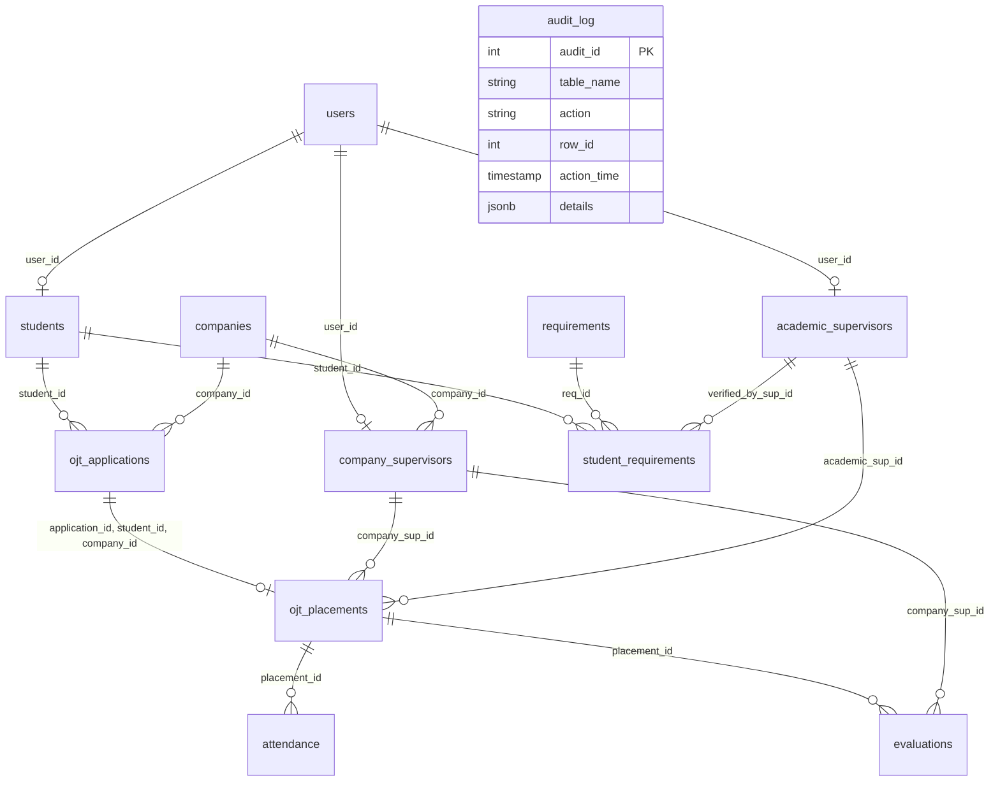

# Project Inspection Report
**Course:** COMP 018 – Database Administration  
**Activity:** Activity 6: Database Backup, Restoration, and Recovery  
**Target System:** OJT Management System  
**Repository:** https://github.com/swvenz/Project-OJT-RMA-System.git  
**Inspection Date:** 2026-11-06  

---

## 1. Executive Summary

A comprehensive architectural and database inspection of the workspace was conducted prior to any database modifications or administrative executions. The inspection analyzed the repository directory structure, configuration files, application source code, compiled artifacts, database migration scripts, and binary archive dumps.

Key highlights from the inspection:
1. **Application Architecture:** Java desktop application utilizing Java Swing for UI, raw JDBC for persistence, and PBKDF2 with HMAC-SHA256 for password hashing.
2. **Database Engine:** PostgreSQL (detected local installation: PostgreSQL 18.6 64-bit on Windows).
3. **Target Database Name:** `ojt_managementdb` (standardized per Activity 6 instructions and README.md).
4. **Critical Artifact Finding:** The repository file `database/OJT Database.sql` is a binary custom-format dump (`pg_dump -Fc`) of an unrelated demonstration database named `Demo` (containing `lending.customers` and `lending.loans`). The actual database schema and role definitions for the OJT Management System are authored in `database/postgresql query.pdf` and implemented in `system/Db.java` and `system/Roles.java`.
5. **Credential Security:** All database passwords and environment credentials remain redacted and protected. No plaintext passwords or secrets are committed or displayed.

---

## 2. Directory Structure Analysis

```text
c:\Users\Matt\Downloads\ACTIVITY 6 G3\
└── Project-OJT-RMA-System\
    ├── .git/                      # Git version control metadata
    ├── .env                       # Environment configuration (connection variables)
    ├── README.md                  # Project overview, requirements, setup guide
    ├── database/
    │   ├── OJT Database.sql       # Binary pg_dump custom archive (Demo / lending)
    │   └── postgresql query.pdf   # Official OJT Management System DDL & Role script
    ├── system/
    │   ├── Main.java              # Swing GUI initialization, auth flow, main view
    │   ├── Db.java                # JDBC connection, PBKDF2 hashing, dynamic seeder
    │   ├── Roles.java             # Role-specific business logic and queries
    │   └── Ui.java                # Swing UI rendering components and dialogs
    └── target/
        └── classes/
            ├── db.properties      # Runtime JDBC URL, user, and password
            └── ojt/*.class        # Compiled Java bytecode
```

---

## 3. Database Schema Specification

The OJT Management System schema comprises **12 relational tables**, extensive primary/foreign key relationships, check constraints, unique constraints, and sequences.

### 3.1 Entity Relationship Summary



### 3.2 Table Definitions and Constraints

| Table Name | Primary Key | Foreign Keys | Key Constraints & Checks | Sequences |
| :--- | :--- | :--- | :--- | :--- |
| `users` | `user_id` | *None* | `username` UNIQUE, `email` UNIQUE, `role` CHECK ('ADMIN', 'STUDENT', 'ACADEMIC_SUPERVISOR', 'COMPANY_SUPERVISOR', 'OJT_COORDINATOR') | `users_user_id_seq` |
| `audit_log` | `audit_id` | *None* | System audit entries with JSONB payload | `audit_log_audit_id_seq` |
| `students` | `student_id` | `user_id` &rarr; `users(user_id)` | `user_id` UNIQUE, `student_number` UNIQUE, `year_level > 0` | `students_student_id_seq` |
| `companies` | `company_id` | *None* | `company_name` UNIQUE, `is_partner` DEFAULT false | `companies_company_id_seq` |
| `academic_supervisors` | `academic_sup_id` | `user_id` &rarr; `users(user_id)` | `user_id` UNIQUE | `academic_supervisors_academic_sup_id_seq` |
| `company_supervisors` | `company_sup_id` | `user_id` &rarr; `users(user_id)`, `company_id` &rarr; `companies(company_id)` | `user_id` UNIQUE | `company_supervisors_company_sup_id_seq` |
| `requirements` | `req_id` | *None* | `title` UNIQUE, `is_mandatory` DEFAULT true | `requirements_req_id_seq` |
| `ojt_applications` | `application_id` | `student_id` &rarr; `students`, `company_id` &rarr; `companies` | `status` CHECK ('Pending', 'Approved', 'Rejected', 'Withdrawn'), UNIQUE (`application_id`, `student_id`, `company_id`) | `ojt_applications_application_id_seq` |
| `student_requirements` | `student_req_id` | `student_id` &rarr; `students`, `req_id` &rarr; `requirements`, `verified_by_sup_id` &rarr; `academic_supervisors` | UNIQUE (`student_id`, `req_id`), `status` CHECK ('Pending', 'Submitted', 'Approved', 'Rejected') | `student_requirements_student_req_id_seq` |
| `ojt_placements` | `placement_id` | Composite FK (`application_id`, `student_id`, `company_id`) &rarr; `ojt_applications`, `company_sup_id` &rarr; `company_supervisors`, `academic_sup_id` &rarr; `academic_supervisors` | `application_id` UNIQUE, `required_hours > 0`, `start_date <= end_date`, `status` CHECK ('Pending', 'Active', 'Completed', 'Terminated') | `ojt_placements_placement_id_seq` |
| `attendance` | `attendance_id` | `placement_id` &rarr; `ojt_placements` | UNIQUE (`placement_id`, `attendance_date`), `hours_rendered >= 0`, `CHECK (time_in IS NULL OR time_out IS NULL OR time_out >= time_in)` | `attendance_attendance_id_seq` |
| `evaluations` | `evaluation_id` | `placement_id` &rarr; `ojt_placements`, `company_sup_id` &rarr; `company_supervisors` | `score >= 0 AND score <= 100` | `evaluations_evaluation_id_seq` |

---

## 4. Database Connection Configuration & Nomenclature

Inspection revealed three distinct references to database naming across project files:
1. `.env`: `DB_NAME=ojt_management`
2. `target/classes/db.properties`: `url=jdbc:postgresql://localhost:5432/OJT_Mangementdb`
3. `README.md` and Activity 6 prompt: `ojt_managementdb`

**Administrative Resolution:**
Per the course specification for Activity 6, the production/source database is established and referenced as **`ojt_managementdb`**.

Connection parameters:
- **Host:** `localhost`
- **Port:** `5432`
- **Superuser:** `postgres`
- **Database:** `ojt_managementdb`
- **Credentials:** Managed via PostgreSQL secure prompts and credential storage (`.pgpass` / interactive prompt); credentials are never logged or exposed.

---

## 5. PostgreSQL Roles and Least-Privilege Access Control

The database design implements role-based access control (RBAC) with 5 dedicated login roles:

1. **`ojt_admin`**: Full administrative access to `users` and sequence `users_user_id_seq`, read-only access to `audit_log`.
2. **`ojt_student`**: Self-service access to application requirements, placements, and attendance logging; insert/update on `ojt_applications`, `student_requirements`, and `attendance`.
3. **`ojt_academic_supervisor`**: Read access across student placements, column-level update privilege on `student_requirements` (`verified_by_sup_id`, `status`, `verified_at`, `remarks`), `ojt_placements` (`status`), and `attendance` (`is_verified`).
4. **`ojt_company_supervisor`**: Evaluation scoring, attendance logging and review, and company profile viewing.
5. **`ojt_coordinator`**: Overall internship workflow administration, partner company management, supervisor assignments, and application approvals.

---

## 6. Seed Data & Baseline Records

The application and migration scripts provide starter testing data:
- **Default Requirements:** `"Resume"`, `"Parent consent"`, `"Medical certificate"`.
- **Default Partner Company:** `"Acme Corp"` (Technology, Manila, Partner = true).
- **Default User Accounts:**
  - `demo_admin` (ADMIN)
  - `demo_student` (STUDENT)
  - `demo_academic_supervisor` (ACADEMIC_SUPERVISOR)
  - `demo_company_supervisor` (COMPANY_SUPERVISOR)
  - `demo_ojt_coordinator` (OJT_COORDINATOR)
- Password security: Pre-hashed using PBKDF2-HMAC-SHA256 with 65,536 iterations and a 16-byte cryptographically secure random salt.

---

## 7. Inspection Findings & Technical Observations

> [!WARNING]
> **Observation regarding `database/OJT Database.sql`:**
> Running `pg_restore --list "database/OJT Database.sql"` revealed that this file is an archived binary dump of a `Demo` database containing a `lending` schema (`customers`, `loans`). It was committed during earlier exercises.
> The true OJT database schema is preserved in `database/postgresql query.pdf`. For Activity 6, we must ensure `ojt_managementdb` contains the authentic 12-table OJT Management System schema before creating the Activity 6 baseline backup.

> [!NOTE]
> **Environment & Tooling Readiness:**
> PostgreSQL 18.6 client binaries (`pg_dump.exe`, `pg_restore.exe`, `psql.exe`, `createdb.exe`) are installed at `C:\Program Files\PostgreSQL\18\bin\`.

