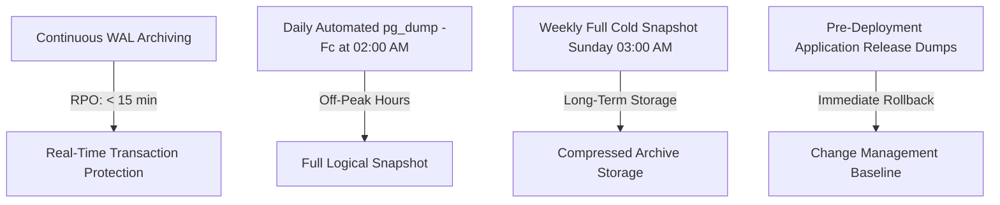

# BrewPOS — Enterprise Database Backup & Disaster Recovery Plan
**Course:** COMP 018 — Database Administration  
**Project:** BrewPOS — Café Point-of-Sale System  
**Database:** `grp_brewposdb`  
**Engine:** PostgreSQL 18+ (Compatible with PostgreSQL 16+)  
**Target Environment:** Windows 10/11 x64, Java 17, Spring Boot, Spring Data JPA  

---

## 1. Executive Summary & Objectives

The primary objective of this Database Backup & Disaster Recovery Plan is to guarantee business continuity, financial audit compliance, and data resilience for **BrewPOS (Café Point-of-Sale System)**. A café point-of-sale system processes continuous customer payments, generates inventory line items, and maintains immutable transaction logs. Any unscheduled downtime or data loss directly results in lost revenue, unrecorded register balances, and discrepancies in daily sales reports.

This plan defines the backup strategy, architectural parameters, scheduling, storage security, and procedural checklists required to achieve strict **Recovery Point Objectives (RPO)** and **Recovery Time Objectives (RTO)**.

---

## 2. Database Architecture & Inventory of Backup Objects

The backup architecture encompasses the entire `public` schema of the `grp_brewposdb` database:

| Object Category | Object Name | Type / Key Characteristics | Criticality |
|---|---|---|:---:|
| **Relational Table** | `public.staff` | Base Table (`staff_id` SERIAL PK, `role` CHECK) | HIGH |
| **Relational Table** | `public.menu_category` | Base Table (`category_id` SERIAL PK, `category_name` UNIQUE) | HIGH |
| **Relational Table** | `public.menu_item` | Base Table (`item_id` SERIAL PK, FK to category, `price` CHECK) | HIGH |
| **Relational Table** | `public.order_ticket` | Base Table (`order_id` SERIAL PK, FK to staff, `payment_method` CHECK) | CRITICAL |
| **Relational Table** | `public.order_line_item` | Base Table (Composite PK: `order_id`, `item_id`, FKs to ticket & item) | CRITICAL |
| **Sequences (4)** | `staff_staff_id_seq`<br>`menu_category_category_id_seq`<br>`menu_item_item_id_seq`<br>`order_ticket_order_id_seq` | Identity / Serial Auto-Increment Generators | CRITICAL |
| **Integrity Constraints** | 5 Primary Keys, 4 Foreign Keys, 2 Unique, 5 Check, 18 Not-Null | Enforces business rules and prevents referential orphan tuples | CRITICAL |
| **Indexes** | B-tree PK & Unique Indexes + `idx_order_ticket_timestamp`, `idx_order_line_item_item_id` | Accelerates daily sales reporting and joins | HIGH |
| **Security & ACLs** | Role-Based Access Control Grants | Privileges for `brewpos_app`, `app_runtime_grp`, `app_readonly_grp`, `app_admin_grp` | CRITICAL |

---

## 3. Backup Methodology & Technical Justification

### 3.1 Logical Backup with PostgreSQL `pg_dump`
- **Utility:** `pg_dump`
- **Output Format:** Custom Archive Format (`-Fc` / Custom Compressed Binary)
- **Compression:** Built-in `gzip` level 6 compression.
- **Technical Justification:**
  1. **Selective Table-Level Restoration:** Unlike plain SQL script dumps (`-Fp`), the custom format allows `pg_restore` to selectively restore individual tables, schemas, or specific Table of Contents (TOC) entries without parsing huge text files.
  2. **Multi-Threaded Parallel Restoration:** The `-Fc` archive supports parallel jobs (`pg_restore -j <N>`), drastically reducing RTO during disaster recovery.
  3. **Platform Independence:** Binary archives can be restored across different operating systems and compatible PostgreSQL minor/major engine versions.
  4. **Data Integrity & Compact Footprint:** Compressed binary archives minimize disk storage footprint while embedding metadata checksums for internal corruption detection.

### 3.2 Backup Execution Syntax
```powershell
pg_dump -U postgres -h localhost -p 5432 -Fc -d grp_brewposdb -f "C:\Users\Matt\pg_backups\brewpos\grp_brewposdb_activity6.dump"
```

---

## 4. Recovery Point Objective (RPO) and Recovery Time Objective (RTO)

| Metric | Target Window | Operational & Business Justification |
|---|---|---|
| **RPO (Recovery Point Objective)** | **15 Minutes** | In a bustling café environment, losing more than 15 minutes of orders causes intolerable customer disputes, untracked cash receipts, and cashier variance during shift closing. Achieved via continuous Write-Ahead Logging (WAL archiving) in production and scheduled high-frequency dumps. |
| **RTO (Recovery Time Objective)** | **30 Minutes** | Maximum allowable duration from incident declaration to full service availability. 30 minutes permits the DBA to spin up a replacement database instance, restore the 17.5 KB (to 500 MB) database archive via `pg_restore`, run automated verification queries, and repoint Spring Boot `DB_URL`. |

---

## 5. Storage Architecture, Security, and Protection

1. **Storage Location:** Dedicated, isolated backup path on local/remote storage:
   `C:\Users\Matt\pg_backups\brewpos\` (outside the web server root and Git working directory).
2. **Access Controls (Least Privilege):**
   - NTFS File System ACLs restrict directory access strictly to the `postgres` service account and the designated Database Administrator (`Matt` / `DBA Group`).
   - Read/write access is denied to web application runtime users, developers, and public network shares.
3. **Git Protection:**
   - Git repository `.gitignore` explicitly excludes all `*.dump`, `*.backup`, `*.sql.bak`, and `.env` files to prevent accidental leakage of sensitive customer order records or credentials into public repositories.
4. **Cryptographic Validation:**
   - Every generated backup must immediately have its SHA-256 hash computed via `Get-FileHash -Algorithm SHA256`.
   - The checksum is recorded alongside the archive in a dedicated `.sha256` manifest for tamper detection.

---

## 6. Proposed Backup Schedule & Retention Policy

### 6.1 Multi-Tiered Backup Schedule



1. **Continuous WAL Archiving (Production Tier):** Captures transaction logs continuously every 5 to 15 minutes for Point-In-Time Recovery (PITR).
2. **Daily Logical Dumps (`pg_dump -Fc`):** Automated off-peak execution at 02:00 AM daily when the café is closed.
3. **Weekly Baseline Snapshot:** Comprehensive vacuumed snapshot generated every Sunday at 03:00 AM.
4. **Pre-Deployment Snapshots:** Mandatory manual execution prior to executing any DDL schema migration or Spring Boot version upgrade.

### 6.2 Grandfather-Father-Son (GFS) Retention Policy
- **Daily Backups (Son):** Retained for **7 calendar days** on high-speed local disk storage.
- **Weekly Backups (Father):** Retained for **4 weeks** on secondary network storage.
- **Monthly Backups (Grandfather):** Retained for **12 calendar months** in encrypted immutable cold storage for annual tax audits and financial reporting compliance.
- **Automated Pruning:** PowerShell retention scripts automatically purge archives exceeding their retention threshold to avoid disk exhaustion.

---

## 7. Role & Privilege Recreation Procedures (Activity 4 RBAC)

> [!IMPORTANT]
> In PostgreSQL, roles (`pg_roles`), cluster users, and global permissions are **cluster-wide** objects. A database-level backup (`pg_dump -d grp_brewposdb`) backs up objects, tables, and Access Control Lists (ACLs) within that database, but does **not** include the `CREATE ROLE` DDL commands.

### 7.1 Disaster Recovery Role Provisioning Sequence
When restoring `grp_brewposdb` onto a newly provisioned PostgreSQL instance or bare-metal server, follow this sequential procedure:

1. **Step 1 — Global Role Dump or RBAC Script Re-Run:**
   Execute the dedicated Activity 4 setup script ([database/05_create_app_role.sql](../database/05_create_app_role.sql)) or restore global roles using `pg_dumpall`:
   ```bash
   # Option A: Global cluster role dump (DBA level)
   pg_dumpall -U postgres -h localhost -p 5432 --globals-only -f "cluster_globals.sql"
   psql -U postgres -h new_host -p 5432 -f "cluster_globals.sql"

   # Option B: Re-executing BrewPOS Activity 4 RBAC scripts
   psql -U postgres -h new_host -p 5432 -d postgres -c "CREATE DATABASE grp_brewposdb;"
   psql -U postgres -h new_host -p 5432 -d grp_brewposdb -f database/05_create_app_role.sql
   ```

2. **Step 2 — Execute Database Restore:**
   ```bash
   pg_restore -U postgres -h new_host -p 5432 -d grp_brewposdb -v "C:\Users\Matt\pg_backups\brewpos\grp_brewposdb_activity6.dump"
   ```

3. **Step 3 — Validate ACL Attachment:**
   Query `information_schema.role_table_grants` to verify that permissions automatically map to the existing roles (`brewpos_app`, `app_runtime_grp`, `app_readonly_grp`, `app_admin_grp`).

---

## 8. Backup Verification & Health Audit Protocols

An unverified backup file provides zero guarantee of recoverability. The BrewPOS backup policy mandates a three-step validation pipeline:

1. **Format & Integrity Check (`pg_restore --list`):**
   Execute Table of Contents inspection immediately following backup generation to verify the archive is readable and uncorrupted:
   ```bash
   pg_restore --list "C:\Users\Matt\pg_backups\brewpos\grp_brewposdb_activity6.dump"
   ```
2. **Cryptographic Checksum Matching:**
   Calculate and record the SHA-256 hash immediately after creation. Prior to any restore, verify `Get-FileHash` matches the stored `.sha256` digest.
3. **Isolated Test Restoration Drill:**
   Regularly restore the archive into an isolated test sandbox (`grp_brewposdb_restore_test`) and execute the automated verification suite (`verification.sql`) to validate 100% table schema, row count parity, and relational constraint integrity.

