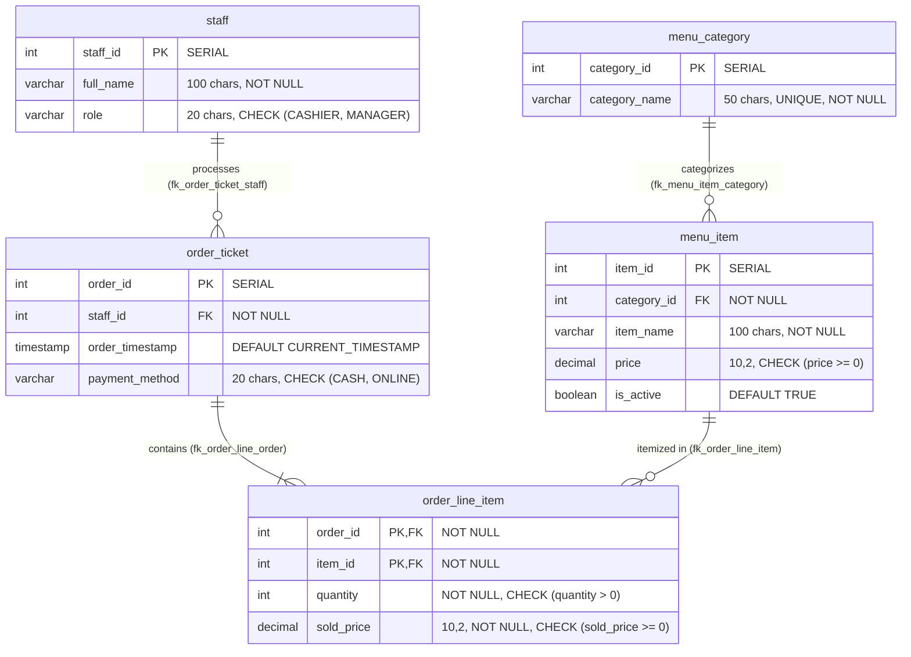

# BrewPOS — Database Architecture & Project Inspection Report
**Course:** COMP 018 — Database Administration  
**Project:** BrewPOS — Café Point-of-Sale System  
**Evaluating Group:** Group 4 (Olivarez, Charles Kean E., Infantado, Gerwin G., Pocsidio, Jhon Louie F., Abangan, SJ Kaizen M., Bartolata, Redge Raindel N.)  
**Repository:** [https://github.com/Nycri/brewpos](https://github.com/Nycri/brewpos)  
**Database Name:** `grp_brewposdb`  
**Schema:** `public`  
**Engine:** PostgreSQL 18.6 on x86_64-windows (MSVC 64-bit)  
**Inspection Date:** November 6, 2026  

---

## 1. Project Overview & Repository File Inventory

A comprehensive inspection of the BrewPOS project repository was conducted. The project is an enterprise-grade Café Point-of-Sale web application featuring a Java 17 / Spring Boot backend with Spring Data JPA and HikariCP connection pooling, interfacing with a PostgreSQL relational database.

### 1.1 Inspected File Hierarchy
- **Database Scripts:**
  - `database/schema.sql`: Full DDL script defining all 5 relational tables, primary keys, foreign keys, check and unique constraints, and B-tree indexes.
  - `database/seed.sql`: Idempotent data seeder populating staff, menu categories, active/inactive products, and sample customer transactions.
  - `database/01_create_tables.sql` to `database/06_align_existing_db.sql`: Modular migration and alignment scripts.
  - `database/DATABASE_DOCUMENTATION.md`: Schema dictionary, architectural justifications, and query profiles.
  - `database/README.md`: Setup, database initialization, and role hardening instructions.
- **Security & Access Control Documentation:**
  - `docs/user-roles.md`: Comprehensive mapping of application roles (Store Manager, Cashier, Auditor) to PostgreSQL database group roles.
  - `access-control/`: Existing Activity 4 documentation and peer evaluation dossiers.
- **Maintenance & Monitoring Documentation:**
  - `activity-5/`: Existing Activity 5 documentation, vacuum statistics, and EXPLAIN query profiles.
- **Disaster Recovery Documentation:**
  - `activity-6/`: Existing Activity 6 peer database evaluation reports and evidence dossiers (`Evidence-act6/`).
- **Application Configuration:**
  - `.env.example`: Template for environment-specific connection strings (`DB_URL`, `DB_USERNAME`, `DB_PASSWORD`, `SERVER_PORT`).
  - `.env`: Protected local configuration file (excluded from Git).

---

## 2. Relational Schema & Table Specifications

The BrewPOS database schema adheres strictly to third normal form (3NF) across exactly five relational tables in the `public` schema.

### 2.1 Table Details & Column Specifications

1. **`public.staff`**
   - `staff_id`: `integer` (SERIAL), NOT NULL, Primary Key (`staff_pkey`).
   - `full_name`: `character varying(100)`, NOT NULL.
   - `role`: `character varying(20)`, NOT NULL, Constraint: `CHECK (role IN ('CASHIER', 'MANAGER'))`.

2. **`public.menu_category`**
   - `category_id`: `integer` (SERIAL), NOT NULL, Primary Key (`menu_category_pkey`).
   - `category_name`: `character varying(50)`, NOT NULL, Constraint: `uq_menu_category_name UNIQUE`.

3. **`public.menu_item`**
   - `item_id`: `integer` (SERIAL), NOT NULL, Primary Key (`menu_item_pkey`).
   - `category_id`: `integer`, NOT NULL, Foreign Key (`fk_menu_item_category`) referencing `menu_category(category_id)`.
   - `item_name`: `character varying(100)`, NOT NULL.
   - `price`: `numeric(10,2)`, NOT NULL, Constraint: `CHECK (price >= 0)`.
   - `is_active`: `boolean`, NOT NULL, DEFAULT `true`.
   - Unique Constraint: `uq_menu_item_category_name UNIQUE (category_id, item_name)`.

4. **`public.order_ticket`**
   - `order_id`: `integer` (SERIAL), NOT NULL, Primary Key (`order_ticket_pkey`).
   - `staff_id`: `integer`, NOT NULL, Foreign Key (`fk_order_ticket_staff`) referencing `staff(staff_id)`.
   - `order_timestamp`: `timestamp without time zone`, NOT NULL, DEFAULT `CURRENT_TIMESTAMP`.
   - `payment_method`: `character varying(20)`, NOT NULL, Constraint: `CHECK (payment_method IN ('CASH', 'ONLINE'))`.

5. **`public.order_line_item`**
   - `order_id`: `integer`, NOT NULL, Foreign Key (`fk_order_line_order`) referencing `order_ticket(order_id)`.
   - `item_id`: `integer`, NOT NULL, Foreign Key (`fk_order_line_item`) referencing `menu_item(item_id)`.
   - `quantity`: `integer`, NOT NULL, Constraint: `CHECK (quantity > 0)`.
   - `sold_price`: `numeric(10,2)`, NOT NULL, Constraint: `CHECK (sold_price >= 0)`.
   - Primary Key: `pk_order_line_item PRIMARY KEY (order_id, item_id)` (Composite Primary Key; no surrogate key).

---

## 3. Constraints, Indexes, and Sequences

### 3.1 Foreign Key Referential Actions
All four foreign keys enforce strict referential integrity **without** cascading deletes (`NO CASCADE` / `RESTRICT`). Deleting a referenced parent row (such as a menu category with active items or a staff member with recorded orders) is strictly rejected by the database engine:
- `fk_menu_item_category`: `menu_item(category_id) -> menu_category(category_id)`
- `fk_order_ticket_staff`: `order_ticket(staff_id) -> staff(staff_id)`
- `fk_order_line_order`: `order_line_item(order_id) -> order_ticket(order_id)`
- `fk_order_line_item`: `order_line_item(item_id) -> menu_item(item_id)`

### 3.2 Indexes
Seven B-tree indexes are active in the live database:
- `staff_pkey` (on `staff(staff_id)`)
- `menu_category_pkey` (on `menu_category(category_id)`)
- `uq_menu_category_name` (on `menu_category(category_name)`)
- `menu_item_pkey` (on `menu_item(item_id)`)
- `uq_menu_item_category_name` (on `menu_item(category_id, item_name)`)
- `order_ticket_pkey` (on `order_ticket(order_id)`)
- `pk_order_line_item` (on `order_line_item(order_id, item_id)`)

### 3.3 Sequences
Four PostgreSQL auto-increment sequences are active:
- `staff_staff_id_seq` (Current value: 2)
- `menu_category_category_id_seq` (Current value: 3)
- `menu_item_item_id_seq` (Current value: 11)
- `order_ticket_order_id_seq` (Current value: 5)

---

## 4. Live Database State & Baseline Row Counts

A live inspection of `grp_brewposdb` confirmed the presence of baseline sample data:

| Table Name | Live Row Count | Baseline Sample Records Description |
|---|:---:|---|
| **`staff`** | **2** | 1 Cashier (`Demo Cashier`), 1 Manager (`Demo Manager`) |
| **`menu_category`** | **3** | `Coffee`, `Non-Coffee`, `Pastries` |
| **`menu_item`** | **11** | 10 active products (e.g. Americano, Matcha Latte, Croissant) + 1 unreferenced inactive item (`Pumpkin Spice Latte`) |
| **`order_ticket`** | **5** | 3 completed orders from today + 2 historical orders from yesterday |
| **`order_line_item`** | **9** | 9 itemized sales lines distributed across the 5 orders |

---

## 5. Security Architecture & Role-Based Access Control

The live database server contains both cluster group roles and application runtime accounts:
- **`postgres`**: Cluster Superuser, owner of all database objects.
- **`app_runtime_grp`**: Point-of-Sale operational role with `SELECT` on `staff`, `SELECT, INSERT, UPDATE, DELETE` on menu catalogs, and `SELECT, INSERT` on orders.
- **`app_readonly_grp`**: Read-only auditor role with `SELECT` on all five tables.
- **`app_admin_grp`**: Catalog administrator role with full privileges on menu items and categories.
- **`brewpos_app`**: Dedicated non-superuser login account utilized by the Spring Boot connection pool.

---

## 6. Source-of-Truth Comparison: Live Database vs. Repository SQL Schema

A schema diff between `database/schema.sql` and the live `grp_brewposdb` database was executed.
- **Result:** **100% IDENTICAL.**
- All 5 table structures, data types, constraints, nullability flags, foreign key relationships, and sequences match the source code repository exactly.
- The live database is healthy, contains no corrupted tuples or uncommitted transactions, and is in an ideal state for backup extraction.

