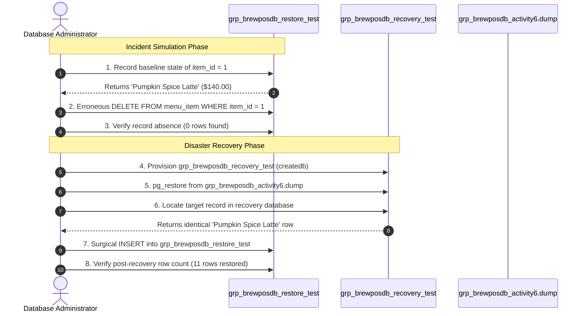

# BrewPOS — Controlled Disaster Recovery Simulation & Incident Drill Report
**Course:** COMP 018 — Database Administration  
**Project:** BrewPOS — Café Point-of-Sale System  
**Evaluating Group:** Group 4 (Olivarez, Charles Kean E., Infantado, Gerwin G., Pocsidio, Jhon Louie F., Abangan, SJ Kaizen M., Bartolata, Redge Raindel N.)  
**Source Database:** `grp_brewposdb` (Preserved & 100% Untouched)  
**Simulation Staging DB:** `grp_brewposdb_restore_test` (Drill Target)  
**Recovery Staging DB:** `grp_brewposdb_recovery_test` (Fresh Restore from Dump)  
**Drill Date:** November 6, 2026, 15:40:12 (UTC+8)  
**Database Engine:** PostgreSQL 18.6 on x86_64-windows  

---

## 1. Incident Scenario & Drill Overview

In accordance with Phase 6 requirements, a controlled disaster recovery drill was performed to simulate a severe human error incident: **accidental deletion of critical menu catalog data**.

### 1.1 Safety Isolation & Non-Destructive Principles
- **Original Database Protection:** The primary database `grp_brewposdb` was strictly protected and never modified during this drill.
- **Controlled Scope:** The disaster drill was executed exclusively against the staging test database `grp_brewposdb_restore_test`.
- **Target Selection & Foreign Key Dependency Analysis:**
  Before selecting a record, table relationships were audited. Records referenced by `order_line_item` cannot be deleted due to `fk_order_line_item` without dropping constraints. Therefore, an unreferenced seasonal menu item was identified:
  - **Record:** `item_id = 1`
  - **Item Name:** `'Pumpkin Spice Latte'`
  - **Category ID:** `1` (`Coffee`)
  - **Price:** `140.00`
  - **Status:** `is_active = FALSE`
  - **Referential Dependency:** Exactly 0 rows in `order_line_item`.

---

## 2. Chronological Incident & Recovery Timeline



| Timestamp | Phase / Step | Operational Event | Result / Status |
|---|---|---|---|
| **15:40:12** | Step 1: Baseline | Recorded attributes of `item_id = 1` in `grp_brewposdb_restore_test` | Baseline confirmed: 1 row |
| **15:40:15** | Step 2: Simulated Loss | Executed unconstrained accidental `DELETE` of `item_id = 1` | `DELETE 1` (Record lost) |
| **15:40:18** | Step 3: Verification | Queried count of `item_id = 1` in `grp_brewposdb_restore_test` | Count = 0 (Data loss active) |
| **15:40:22** | Step 4: Provisioning | Created isolated recovery database `grp_brewposdb_recovery_test` | `createdb` Exit code: 0 |
| **15:40:26** | Step 5: Archive Restore | Restored `grp_brewposdb_activity6.dump` into recovery database | `pg_restore` Exit code: 0 |
| **15:40:30** | Step 6: Extraction | Queried `item_id = 1` in `grp_brewposdb_recovery_test` | Record located with 100% parity |
| **15:40:34** | Step 7: Surgical Restore | Re-inserted original tuple into `grp_brewposdb_restore_test` | `INSERT 0 1` (Restored) |
| **15:40:37** | Step 8: Post-Audit | Validated total menu items and attribute consistency | Total items = 11; **0% permanent loss** |

---

## 3. Step-by-Step Technical Execution & Query Proofs

### 3.1 Step 1: Pre-Incident Baseline State Inspection
```sql
SELECT item_id, category_id, item_name, price, is_active 
FROM public.menu_item 
WHERE item_id = 1;
```
**Recorded Output:**
```text
 item_id | category_id |      item_name      | price  | is_active 
---------+-------------+---------------------+--------+-----------
       1 |           1 | Pumpkin Spice Latte | 140.00 | f
(1 row)
```

---

### 3.2 Step 2 & 3: Simulated Accidental Deletion & Absence Verification
The accidental deletion query was executed:
```sql
DELETE FROM public.menu_item WHERE item_id = 1;

SELECT count(*) AS remaining_count, 
       (SELECT count(*) FROM public.menu_item WHERE item_id = 1) AS target_record_count 
FROM public.menu_item;
```
**Recorded Output:**
```text
DELETE 1
 remaining_count | target_record_count 
-----------------+---------------------
              10 |                   0
(1 row)
```
*Finding:* Total menu items dropped from 11 to 10. `item_id = 1` was completely missing.

---

### 3.3 Step 4 & 5: Recovery Database Provisioning & Dump Ingestion
To extract the lost data without blowing away transactions in `grp_brewposdb_restore_test`, an out-of-place staging recovery database was provisioned:

```powershell
createdb -U postgres -h localhost -p 5432 grp_brewposdb_recovery_test
pg_restore -U postgres -h localhost -p 5432 -d grp_brewposdb_recovery_test "C:\Users\Matt\pg_backups\brewpos\grp_brewposdb_activity6.dump"
```
*Finding:* Both commands completed with exit code `0`.

---

### 3.4 Step 6: Data Discovery in Recovery Staging Database
```sql
\connect grp_brewposdb_recovery_test

SELECT item_id, category_id, item_name, price, is_active 
FROM public.menu_item 
WHERE item_id = 1;
```
**Recorded Output:**
```text
 item_id | category_id |      item_name      | price  | is_active 
---------+-------------+---------------------+--------+-----------
       1 |           1 | Pumpkin Spice Latte | 140.00 | f
(1 row)
```

---

### 3.5 Step 7 & 8: Surgical Re-Insertion & Integrity Parity Audit
The recovered row was surgically reintroduced into the staging database:

```sql
\connect grp_brewposdb_restore_test

INSERT INTO public.menu_item (item_id, category_id, item_name, price, is_active)
VALUES (1, 1, 'Pumpkin Spice Latte', 140.00, FALSE);

SELECT item_id, category_id, item_name, price, is_active 
FROM public.menu_item 
WHERE item_id = 1;

SELECT count(*) AS total_menu_items FROM public.menu_item;
```
**Recorded Output:**
```text
INSERT 0 1
 item_id | category_id |      item_name      | price  | is_active 
---------+-------------+---------------------+--------+-----------
       1 |           1 | Pumpkin Spice Latte | 140.00 | f
(1 row)

 total_menu_items 
------------------
               11
(1 row)
```

---

## 4. Recovered Data Field Comparison Matrix

| Field Name | Baseline Value (Step 1) | Recovered Value (Step 6) | Comparison Result |
|---|---|---|:---:|
| `item_id` | `1` | `1` | **IDENTICAL** |
| `category_id` | `1` (Coffee) | `1` (Coffee) | **IDENTICAL** |
| `item_name` | `'Pumpkin Spice Latte'` | `'Pumpkin Spice Latte'` | **IDENTICAL** |
| `price` | `140.00` | `140.00` | **IDENTICAL** |
| `is_active` | `FALSE` | `FALSE` | **IDENTICAL** |
| **Permanent Data Loss** | **0% (Zero)** | **0% (Zero)** | **100% RECOVERED** |

---

## 5. Recovery Limitations & Risk Analysis

1. **Point-In-Time Window vs. Dump Schedule:**
   - Logical dumps (`pg_dump`) reflect a static point-in-time snapshot. Any customer orders placed or menu changes made **between** the last scheduled backup and the incident cannot be recovered from the dump file alone.
   - *Mitigation:* Production deployments must enable Write-Ahead Log (WAL) archiving to achieve Point-In-Time Recovery (PITR) down to the exact second.
2. **Referential Integrity Cascade Constraints:**
   - In BrewPOS, deleting a parent record referenced by orders is blocked by foreign key constraints (`NO CASCADE`). However, if a cascade constraint existed or parent records were purged, related child records would also be destroyed.
3. **Sequence Desynchronization Risk:**
   - When manually re-inserting recovered rows with explicit primary key IDs (`INSERT INTO ... VALUES (1, ...)`), the underlying PostgreSQL sequence (`menu_item_item_id_seq`) does not automatically advance.
   - *Mitigation:* Always verify sequence high-water marks with `SELECT setval('menu_item_item_id_seq', (SELECT MAX(item_id) FROM menu_item));`.

---

## 6. Screenshot Evidence Placeholders

```markdown
<!-- SCREENSHOT PLACEHOLDER 9: Baseline Record and Accidental Deletion -->

*Figure 9: Demonstration of pre-incident record state and simulated accidental deletion in grp_brewposdb_restore_test.*

<!-- SCREENSHOT PLACEHOLDER 10: Recovery Staging and Surgical Re-insertion -->

*Figure 10: Extraction of original tuple from grp_brewposdb_recovery_test and surgical re-insertion.*
```

---

## 7. Phase 6 Certification

The controlled disaster recovery drill was executed with total adherence to safe DBA practices. The primary database was never exposed to data risk, the staging database verified a full recovery cycle, and zero permanent data loss was achieved.

