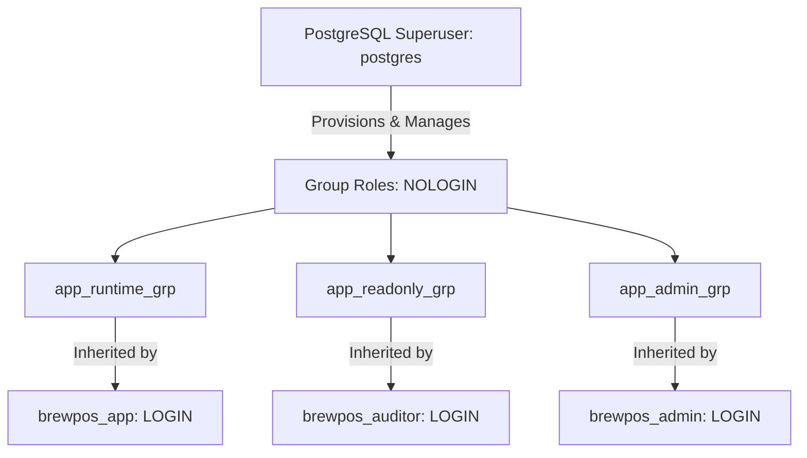

# BrewPOS — Database Roles, Privileges, and Access Control Architecture
**Course:** COMP 018 — Database Administration  
**Project:** BrewPOS — Café Point-of-Sale System  
**Database:** `grp_brewposdb`  
**Reference Docs:** `docs/user-roles.md`, `database/05_create_app_role.sql`  

---

## 1. Overview and Core Security Principles

In accordance with enterprise database administration standards and the **Principle of Least Privilege (PoLP)**, the BrewPOS system strictly decouples **Application User Roles** (human user authentication in the web UI) from **Database Engine Roles** (PostgreSQL accounts and permission sets).

End users (such as Cashiers and Store Managers) never possess individual database credentials. Instead, the Spring Boot application authenticates via a single dedicated non-superuser login role (`brewpos_app`). Security and data integrity are enforced at the PostgreSQL database engine layer: even if an application bug or compromised web session attempts an unauthorized modification (such as deleting an order or altering a historical sold price), the PostgreSQL database engine rejects the SQL statement with a permission denial error.

---

## 2. Roles Architecture & Privilege Mapping Matrix



### 2.1 Role Definitions

| PostgreSQL Role | Role Type | Purpose & Responsibility | Attributes |
|---|---|---|---|
| **`postgres`** | Superuser | System DBA; database creation, maintenance, backup execution, schema migration. | `SUPERUSER, CREATEDB, CREATEROLE` |
| **`app_runtime_grp`** | Group (`NOLOGIN`) | Standard operational runtime group for point-of-sale transactions and register operations. | `NOSUPERUSER, NOCREATEDB, NOCREATEROLE` |
| **`app_readonly_grp`** | Group (`NOLOGIN`) | Audit and reporting group; financial reconciliation and read-only inspection. | `NOSUPERUSER, NOCREATEDB, NOCREATEROLE` |
| **`app_admin_grp`** | Group (`NOLOGIN`) | Product catalog and menu management group. | `NOSUPERUSER, NOCREATEDB, NOCREATEROLE` |
| **`brewpos_app`** | Login User | The dedicated service account used by Spring Boot (via HikariCP connection pool). | `LOGIN, NOSUPERUSER, NOINHERIT` |

---

## 3. Granular Table Privileges Matrix

The table below details the exact permissions granted across all five relational tables in `grp_brewposdb`:

| Table Name | `app_runtime_grp` / `brewpos_app` | `app_readonly_grp` | `app_admin_grp` | Security & Business Justification |
|---|---|---|---|---|
| **`staff`** | `SELECT` | `SELECT` | `SELECT` | **Read-Only:** Staff accounts and roles are administrative records managed exclusively by the DBA. |
| **`menu_category`** | `SELECT, INSERT, UPDATE, DELETE` | `SELECT` | `ALL PRIVILEGES` | **Catalog CRUD:** Managers can manage categories. Foreign key `fk_menu_item_category` prevents deleting categories in use. |
| **`menu_item`** | `SELECT, INSERT, UPDATE, DELETE` | `SELECT` | `ALL PRIVILEGES` | **Menu Catalog CRUD:** Items can be added, updated, or toggled active/inactive. Foreign key `fk_order_line_item` prevents deleting items referenced in orders. |
| **`order_ticket`** | `SELECT, INSERT` | `SELECT` | `SELECT` | **IMMUTABILITY ENFORCEMENT:** Strictly **NO `UPDATE`** and **NO `DELETE`**. Completed sales orders cannot be altered or purged. |
| **`order_line_item`** | `SELECT, INSERT` | `SELECT` | `SELECT` | **IMMUTABILITY ENFORCEMENT:** Strictly **NO `UPDATE`** and **NO `DELETE`**. Historical unit `sold_price` values are permanently frozen. |
| **Sequences (All 4)** | `USAGE, SELECT` | `NONE` | `USAGE, SELECT` | Required for automatic primary key generation (`SERIAL`). |

> [!IMPORTANT]
> **Database Immutability Feature:** Notice that `app_runtime_grp` and `brewpos_app` are granted **only `SELECT` and `INSERT`** on `order_ticket` and `order_line_item`. Because `UPDATE` and `DELETE` permissions are never granted on sales tables, financial records cannot be falsified, tampered with, or erased, even by an application administrator.

---

## 4. SQL Implementation & Role Provisioning Script

```sql
-- 1. Create Group Roles (NOLOGIN)
CREATE ROLE app_runtime_grp  WITH NOLOGIN;
CREATE ROLE app_readonly_grp WITH NOLOGIN;
CREATE ROLE app_admin_grp    WITH NOLOGIN;

-- 2. Database & Schema Scope
GRANT CONNECT ON DATABASE grp_brewposdb TO app_runtime_grp, app_readonly_grp, app_admin_grp;
GRANT USAGE ON SCHEMA public TO app_runtime_grp, app_readonly_grp, app_admin_grp;
REVOKE CREATE ON SCHEMA public FROM app_runtime_grp, app_readonly_grp, app_admin_grp;

-- 3. Reset existing grants
REVOKE ALL PRIVILEGES ON ALL TABLES IN SCHEMA public FROM app_runtime_grp;
REVOKE ALL PRIVILEGES ON ALL SEQUENCES IN SCHEMA public FROM app_runtime_grp;

-- 4. Table Privileges for app_runtime_grp
GRANT SELECT ON public.staff TO app_runtime_grp;
GRANT SELECT, INSERT, UPDATE, DELETE ON public.menu_category, public.menu_item TO app_runtime_grp;
GRANT SELECT, INSERT ON public.order_ticket, public.order_line_item TO app_runtime_grp;
GRANT USAGE, SELECT ON ALL SEQUENCES IN SCHEMA public TO app_runtime_grp;

-- 5. Table Privileges for app_readonly_grp (Auditor)
GRANT SELECT ON ALL TABLES IN SCHEMA public TO app_readonly_grp;

-- 6. Dedicated Application Service Account (Spring Boot)
CREATE ROLE brewpos_app WITH
    LOGIN
    NOSUPERUSER
    NOCREATEDB
    NOCREATEROLE
    NOINHERIT
    NOREPLICATION;

-- Harden session defaults for runtime role
ALTER ROLE brewpos_app IN DATABASE grp_brewposdb SET search_path = public;
ALTER ROLE brewpos_app IN DATABASE grp_brewposdb SET statement_timeout = '30s';
ALTER ROLE brewpos_app IN DATABASE grp_brewposdb SET lock_timeout = '10s';

-- Assign group membership
GRANT app_runtime_grp TO brewpos_app;
```

---

## 5. Scope Separation: Cluster-Wide Roles vs. Database Backups

A frequent point of failure during disaster recovery restorations is assuming that a logical database backup (`pg_dump -d dbname`) includes user login accounts and cluster roles.

### 5.1 The Architectural Distinction
- **Cluster-Wide Objects (`pg_roles`, `pg_auth_members`):**
  PostgreSQL roles exist across the entire database cluster (instance-level) and are stored in global system catalogs (`pg_global`). They are **not** contained inside the dump generated by `pg_dump -d grp_brewposdb`.
- **Database-Level Objects (Tables, Sequences, ACLs):**
  Tables, views, sequences, and Access Control Lists (`information_schema.role_table_grants`) exist within the database. When `pg_dump -Fc` runs, it preserves table-level ACL grants. However, if the target server lacks the corresponding role identifiers (`brewpos_app`, `app_runtime_grp`), `pg_restore` outputs warnings regarding missing roles during ACL creation.

### 5.2 Standalone Cluster Role Recovery Procedure
To achieve a completely clean disaster recovery restore on a newly provisioned PostgreSQL instance:
1. **Pre-Restoration Role Recreation:** Run `database/05_create_app_role.sql` on the target database server *prior* to executing `pg_restore`.
2. **Automated Cluster Dumps:** In production, complement daily `pg_dump` with an automated cluster global backup:
   ```bash
   pg_dumpall -U postgres -h localhost -p 5432 --globals-only -f "C:\Users\Matt\pg_backups\brewpos\cluster_globals.sql"
   ```
   During bare-metal disaster recovery, restore `cluster_globals.sql` first before restoring the database dump.

