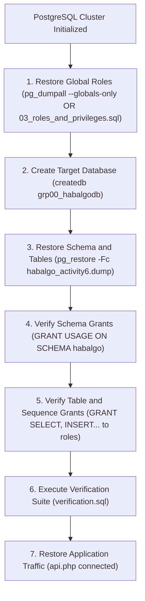

# HabalGo Database Backup and Disaster Recovery Plan
## COMP 018 – Database Administration | Activity 6
**System:** HabalGo – Ride & Booking Management System  
**Database Platform:** PostgreSQL 18.6 (x86_64-windows)  
**Database Name:** `grp00_habalgodb`  
**Schema:** `habalgo`  
**Document Version:** 1.0  
**Effective Date:** 2026-11-06  
**Document Author:** Senior PostgreSQL Database Administrator (Student DBA)  

---

## 1. Objectives and Scope

The primary objective of this Backup and Disaster Recovery Plan is to protect the **HabalGo** relational database against hardware failure, data corruption, unauthorized deletion, accidental modification, and catastrophic software incidents. 

The scope includes all relational entities, structural constraints, sequences, and access control models associated with the ride-hailing and booking operations:
- Customers and ride history
- Drivers and vehicle assignments
- Locations and route endpoints
- Bookings and dispatch status
- Billing, fares, and transaction receipts
- Ratings, reviews, and driver quality feedback

---

## 2. Database and Objects to Back Up

The backup operation targets the entire operational database **`grp00_habalgodb`** with special emphasis on the **`habalgo`** schema and all related database objects:

```
Database: grp00_habalgodb
 └── Schema: habalgo
      ├── Tables (8):
      │    ├── customer
      │    ├── driver
      │    ├── vehicle
      │    ├── driver_vehicle
      │    ├── location
      │    ├── booking
      │    ├── payment
      │    └── rating_feedback
      ├── Sequences (7):
      │    ├── customer_customer_id_seq
      │    ├── driver_driver_id_seq
      │    ├── vehicle_vehicle_id_seq
      │    ├── location_location_id_seq
      │    ├── booking_booking_id_seq
      │    ├── payment_payment_id_seq
      │    └── rating_feedback_rating_id_seq
      ├── Constraints & Primary Keys:
      │    ├── 8 Primary Key B-Tree Indexes
      │    ├── 4 Check Constraints (assignment dates, booking status enum, payment amount, rating range)
      │    ├── 4 Unique Keys (customer email, driver license, vehicle plate, rating uniqueness)
      │    └── 8 Foreign Key Referential Integrity Constraints
      └── Secondary Performance Indexes:
           ├── idx_booking_customer
           ├── idx_booking_driver
           ├── idx_booking_date
           ├── idx_payment_booking
           └── idx_rating_booking
```

---

## 3. Logical Backup Methodology: `pg_dump` Custom Format (`-Fc`)

PostgreSQL provides multiple logical and physical backup mechanisms. For HabalGo, the **`pg_dump` Custom Archive format (`-Fc`)** has been selected as the mandatory standard.

### Technical Justification for Custom Format (`-Fc`)
1. **Built-in Compression:** The `-Fc` flag compresses data at rest using `zlib` compression, reducing backup file size by 60%–80% compared to plain-text SQL files.
2. **Selective Object Restoration:** Unlike plain SQL scripts, custom archive files allow `pg_restore` to selectively restore specific schemas, specific tables, or only table schemas without data.
3. **Restoration Reordering:** `pg_restore` dynamically analyzes foreign-key dependencies and reorders table creation and data loading to prevent referential integrity violations during restoration.
4. **Inspection Capability (`pg_restore --list`):** Administrators can generate a complete Table of Contents (TOC) of the archive without having to extract or restore the dump.
5. **Cross-Platform Portability:** Custom format dumps can be restored across different operating systems (Windows, Linux, macOS) running compatible PostgreSQL engines.

### Standard Backup Command Syntax
```powershell
& "C:\Program Files\PostgreSQL\18\bin\pg_dump.exe" -U postgres -h localhost -p 5432 -Fc -d grp00_habalgodb -f "C:\HabalGo_Backups\habalgo_activity6.dump"
```

---

## 4. Protected Backup Storage Architecture

To uphold security and compliance standards:
1. **Separation from Source Control:** Database dumps must **never** be committed to the Git repository. Dumps are stored in an isolated, external directory (`C:\HabalGo_Backups` or scratch directory) protected by file system Access Control Lists (ACLs).
2. **Repository Safeguards:** The HabalGo Git repository enforces strict `.gitignore` rules blocking `*.dump`, `*.tar`, `*.sql.bak`, and backup folders.
3. **Storage Tiering (3-2-1 Rule):**
   - **3 Copies:** 1 primary live database, 1 local backup image on dedicated disk, 1 secondary archive image.
   - **2 Different Media:** Local solid-state storage and secured network-attached / secondary storage.
   - **1 Offsite / Cloud Copy:** Encrypted archive synchronized offsite daily.
4. **Encryption at Rest:** Secondary and offsite archives must be encrypted using AES-256 before transmission.

---

## 5. Authorized Backup Accounts and Principle of Least Privilege

Database backups must only be initiated by authenticated and authorized administrative identities:
- **`postgres` (Cluster Administrator):** Authorized for full cluster maintenance, global role extraction, and emergency disaster recovery.
- **`habalgo_admin` (Application DBA):** Dedicated database owner account possessing complete DDL and DML privileges over `grp00_habalgodb` and schema `habalgo`.
- **Operational Rule:** Application runtime credentials (`habalgo_app`) and read-only accounts (`habalgo_auditor`) are strictly forbidden from initiating schema dumps to prevent unauthorized credential escalation and exfiltration.

---

## 6. Verification and Integrity Procedures

A backup is not considered valid until its integrity has been empirically tested:
1. **File System Verification:** Confirm existence, non-zero file size, and creation timestamp.
2. **Cryptographic Checksumming:** Compute a SHA-256 hash immediately following backup generation:
   ```powershell
   Get-FileHash -Path "C:\HabalGo_Backups\habalgo_activity6.dump" -Algorithm SHA256
   ```
3. **Archive Header Inspection:** Validate that the custom archive is uncorrupted and contains all expected objects:
   ```powershell
   & "C:\Program Files\PostgreSQL\18\bin\pg_restore.exe" --list "C:\HabalGo_Backups\habalgo_activity6.dump"
   ```
4. **Isolated Test Restoration:** Execute scheduled restoration tests into an isolated test database (e.g., `grp00_habalgodb_activity6_restore_test`) to verify relational constraints and row counts.

---

## 7. Backup Schedule and Retention Policy

| Backup Type | Frequency | Execution Window | Retention Period | Storage Location |
| :--- | :--- | :--- | :--- | :--- |
| **Full Logical Dump (`-Fc`)** | Daily | 02:00 AM PHT | 30 Days | Primary Backup Volume |
| **Cluster Roles Dump (`--globals-only`)** | Daily | 02:15 AM PHT | 30 Days | Primary Backup Volume |
| **Weekly Archive Consolidation** | Weekly (Sunday) | 03:00 AM PHT | 12 Weeks | Secondary Cold Storage |
| **Monthly Milestone Archive** | 1st of every month | 04:00 AM PHT | 1 Year | Offsite Encrypted Storage |

---

## 8. Recovery Objectives (RPO and RTO)

### Recovery Point Objective (RPO)
- **Baseline Definition:** The maximum acceptable period of transactional data loss measured in time.
- **HabalGo Target RPO:** **15 minutes** during peak operational hours (via WAL archiving) and **24 hours** for nightly logical custom dumps.
- **Impact Mitigation:** In the event of a catastrophic system drop at 14:00, logical restoration restores the system to the 02:00 baseline.

### Recovery Time Objective (RTO)
- **Baseline Definition:** The maximum acceptable duration required to restore the database to a fully functional operational state.
- **HabalGo Target RTO:** **30 minutes**.
- **Restoration Benchmarks:** Restoring `grp00_habalgodb` using `pg_restore -Fc` takes under 10 seconds for current data volumes, leaving 29+ minutes for network provisioning, DNS redirection, and application sanity testing.

---

## 9. PostgreSQL Role Recreation and Global Object Handling

> [!WARNING]
> **PostgreSQL Architecture Rule:** Roles, users, passwords, and global server privileges are stored in cluster-wide catalog tables (`pg_authid`, `pg_roles`) that are shared across all databases in the PostgreSQL instance. 
> 
> A standard `pg_dump` targeting a single database (`-d grp00_habalgodb`) **does not and cannot contain cluster roles**.

### Disaster Recovery Strategy for Roles:
1. **Global Dump Extraction:**
   ```powershell
   & "C:\Program Files\PostgreSQL\18\bin\pg_dumpall.exe" -U postgres -h localhost -p 5432 --globals-only -f "C:\HabalGo_Backups\habalgo_globals.sql"
   ```
2. **Manual Role Re-establishment Script:**
   In cases where a bare-metal restore is performed without cluster superuser access, the DDL role creation script (`database/03_roles_and_privileges.sql`) must be executed prior to database restoration:
   - Create group roles: `app_runtime_grp`, `app_readonly_grp`
   - Create login accounts: `habalgo_admin`, `habalgo_app`, `habalgo_auditor`
   - Grant role memberships and database connection privileges

---

## 10. Privilege and Membership Restoration Flow



