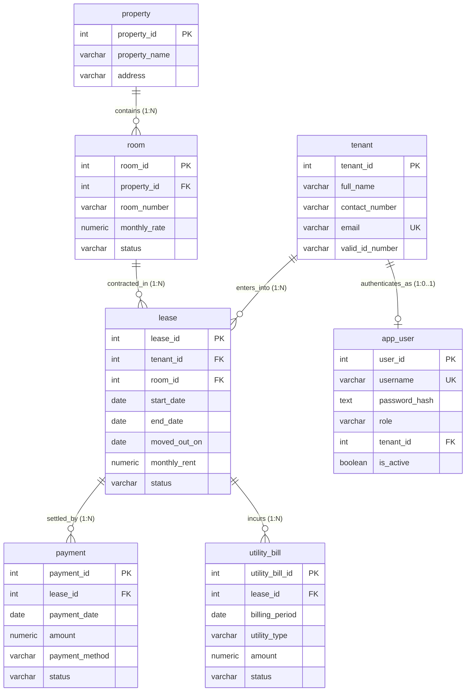

# COMP 018 — Activity 6: Final Technical Report
## Database Backup, Restoration, and Disaster Recovery Management
### Project: BoardTrack — Boarding House & Rental Management System

---

**Course Code & Title:** COMP 018 — Database Administration  
**Academic Period:** Academic Year 2026–2027  
**Student Specialization:** Information Technology  
**Technical Roles:** Senior PostgreSQL Database Administrator / Node.js Developer / Technical Documentation Specialist  
**Target Database:** `boardtrack_db`  
**Host & Port:** `localhost:5432`  
**Database Management System:** PostgreSQL 18.6 on x86_64-windows (msvc-19.44.35228, 64-bit)  
**Document Classification:** Enterprise Technical Deliverable & Academic Audit  
**Date of Submission:** 2026-11-06  

---

## Table of Contents

1. [Project Overview](#1-project-overview)
2. [Database Architecture](#2-database-architecture)
3. [Database Tables, Columns, and Relationships](#3-database-tables-columns-and-relationships)
4. [Enterprise Backup Plan](#4-enterprise-backup-plan)
5. [Backup Method and Technical Rationale](#5-backup-method-and-technical-rationale)
6. [Proposed Backup Schedule](#6-proposed-backup-schedule)
7. [Data Retention Policy (3-2-1 Strategy)](#7-data-retention-policy-3-2-1-strategy)
8. [Recovery Objectives (RPO and RTO)](#8-recovery-objectives-rpo-and-rto)
9. [Backup Commands and Script Execution](#9-backup-commands-and-script-execution)
10. [Backup File Size, Path, and Cryptographic Hash](#10-backup-file-size-path-and-cryptographic-hash)
11. [Archive Inspection and Table of Contents (TOC)](#11-archive-inspection-and-table-of-contents-toc)
12. [Restoration Architecture and Procedures](#12-restoration-architecture-and-procedures)
13. [Restoration Results and Ownership Audit](#13-restoration-results-and-ownership-audit)
14. [Database Verification Suite and Test Matrix](#14-database-verification-suite-and-test-matrix)
15. [PostgreSQL Role and Cluster-Wide Privilege Verification](#15-postgresql-role-and-cluster-wide-privilege-verification)
16. [Access Control and Permission Test Results](#16-access-control-and-permission-test-results)
17. [Controlled Disaster Recovery Simulation Timeline](#17-controlled-disaster-recovery-simulation-timeline)
18. [Recovery Simulation Outcome and Data Comparison](#18-recovery-simulation-outcome-and-data-comparison)
19. [Errors, Edge Cases, and Technical Limitations](#19-errors-edge-cases-and-technical-limitations)
20. [Production DBA Recommendations](#20-production-dba-recommendations)
21. [AI Usage and Academic Integrity Declaration](#21-ai-usage-and-academic-integrity-declaration)

---

## 1. Project Overview

**BoardTrack** is a centralized property and rental management application designed to automate property recordkeeping, accommodation unit management, tenant identity tracking, lease contract enforcement, rental payment collections, and recurring utility billing. 

The software stack integrates:
* **Application Framework:** Node.js (version $\ge$ 20.12), Express 4.19, and EJS server-side templates.
* **Database Driver:** `pg` (Node-Postgres connection pooler).
* **Database Management System:** PostgreSQL 18.6 (written to support features from PostgreSQL 13+).
* **Cryptographic & Indexing Extensions:** `pgcrypto` for bcrypt-compatible password verification (`crypt()`, `gen_salt()`) and `btree_gist` for multivariable GiST exclusion constraints.

In Activity 6 of COMP 018 (Database Administration), the database administrator's objective is to formulate, implement, verify, and document a complete enterprise backup, restoration, and disaster recovery strategy. The activity establishes resilient recovery safeguards, automates backup execution via Windows PowerShell, verifies relational integrity and access controls against the principle of least privilege, and executes a controlled recovery simulation without endangering existing production data.

---

## 2. Database Architecture

The BoardTrack database architecture enforces relational normalization up to Third Normal Form (3NF), separating physical facilities, rentable spaces, tenants, legal contracts, and financial audits.



### Architectural Key Characteristics:
1. **Dynamic Balance Derivation:** Balances are never stored as denormalized table columns. Instead, the view `v_lease_summary` aggregates completed payments (`SUM(payment.amount)`) and utility charges on the fly, eliminating update anomalies.
2. **Defensive Database Triggers:**
   - `trg_lease_sync_room` automatically synchronizes `room.status` between `OCCUPIED` and `AVAILABLE` upon lease insertion, status modification, or termination.
   - `trg_room_status_guard` prevents manual room status changes that contradict active lease intervals.
3. **GiST Exclusion Constraint:** `ex_lease_no_overlap` mathematically prevents overlapping active leases on the same room across date intervals `[start_date, end_date]`.

---

## 3. Database Tables, Columns, and Relationships

The repository defines 7 business tables, 1 migration tracking table, and 1 reporting view:

| Table Name | Prompt Label | Primary Key | Key Foreign Keys & Constraints | Business Purpose |
|---|---|---|---|---|
| `property` | `properties` | `property_id` | PK index; NOT NULL on name/address | Master records of rental buildings. |
| `room` | `rooms` | `room_id` | FK `property_id`; `uq_room_per_property UNIQUE(property_id, room_number)`; `CHECK (monthly_rate > 0)` | Individual accommodation units. |
| `tenant` | `tenants` | `tenant_id` | `UNIQUE(email)`; Contact number NOT NULL | Master directory of registered tenants. |
| `lease` | `leases` | `lease_id` | FK `tenant_id`, FK `room_id`; `CHECK (end_date > start_date)`; `ex_lease_no_overlap` (GiST) | Binding rental contracts and validity dates. |
| `payment` | `payments` | `payment_id` | FK `lease_id`; `CHECK (amount > 0)`; Payment method check | Rent collection transaction ledger. |
| `utility_bill` | `utility_bills`| `utility_bill_id`| FK `lease_id`; `CHECK (EXTRACT(DAY FROM billing_period) = 1)` | Monthly electricity, water, and internet bills. |
| `app_user` | `app_user` | `user_id` | `UNIQUE(username)`; FK `tenant_id`; `CHECK ((role='tenant') = (tenant_id IS NOT NULL))` | Application authentication and user roles. |
| `schema_migrations`| *(system)* | `name` | PK index; `applied_at TIMESTAMPTZ` | Tracks applied migration versions. |

> **Historical Integrity Guarantee:** Every foreign key in BoardTrack enforces `ON DELETE NO ACTION`. Deleting master entities (such as properties or tenants) while historical leases, payments, or bills exist is blocked at the database engine level.

---

## 4. Enterprise Backup Plan

The BoardTrack enterprise backup plan defines a comprehensive strategy designed to protect against hardware failure, operator mistakes, and system compromise:

* **Scope of Protection:** Database `boardtrack_db`, schema `public`, extensions (`btree_gist`, `pgcrypto`), base tables, primary/foreign/unique/check/exclusion constraints, secondary indexes, sequences, procedural functions, triggers, and views.
* **Storage Path:** Dedicated administrative path `C:\PostgreSQL\backups\boardtrack\` (or `activity-6-boardtrack/backups/`), outside the application repository.
* **Access Control:** Restricted via NTFS file permissions to the PostgreSQL service account and database administrators. Application runtime accounts are denied access.
* **Version Control Isolation:** All dump extensions (`*.dump`, `*.backup`, `*.tar`, `*.sql`) are strictly ignored in `.gitignore`.

---

## 5. Backup Method and Technical Rationale

The approved logical backup mechanism is **PostgreSQL `pg_dump`** utilizing the **Custom Archive Format (`-Fc`)**.

```
pg_dump -U <username> -h localhost -p 5432 -Fc -d boardtrack_db -f <backup_path>
```

### Technical Justification for `-Fc`:
1. **Integrated zlib Compression:** The custom archive format applies compression automatically, reducing disk storage and network transmission bandwidth by up to 70% compared to raw plain-text SQL files.
2. **Selective Restoration:** Unlike plain SQL dumps (`-Fp`), `-Fc` archives allow granular restoration of individual tables, schemas, or data without restoring the entire database.
3. **Table of Contents (TOC) Inspection:** The archive contains an embedded binary catalog readable by `pg_restore --list`, allowing immediate pre-restoration validation and audit verification.
4. **Dependency-Aware Reordering:** `pg_restore` dynamically determines optimal object creation order, preventing foreign key violation errors during restoration.
5. **Parallel Multithreading:** Supports parallel table restoration via `pg_restore -j <threads>`, minimizing Recovery Time Objective (RTO).
6. **SQL Injection Resistance:** Stored as serialized PostgreSQL binary structures, preventing script injection or interpretation errors across varying client locales.

---

## 6. Proposed Backup Schedule

To guarantee business continuity without impacting tenant portal response times, the following tiered backup schedule is established:

| Tier | Execution Timing | Backup Type & Format | Target Storage | Retention Window |
|---|---|---|---|---|
| **Daily Full** | 02:00 AM PHT | Logical `pg_dump -Fc` | Local Fast NVMe | 14 Days |
| **Weekly Full** | Sunday 03:00 AM PHT | Logical `pg_dump -Fc` + Cluster Globals | Local Encrypted NAS | 8 Weeks |
| **Monthly Archive** | 1st of month 04:00 AM PHT | Logical `pg_dump -Fc` + Checksum Audit | Geo-Redundant Cloud Vault | 12 Months |
| **Annual Compliance** | December 31 11:00 PM PHT | Full System Snapshot + DDL Export | Offline Cold Archive | 7 Years |

---

## 7. Data Retention Policy (3-2-1 Strategy)

BoardTrack enforces the industry-standard **3-2-1 Data Preservation Rule**:
1. **3 Copies of Data:** Production operational database, primary on-site backup storage, and secondary off-site replica.
2. **2 Different Storage Media:** High-speed local solid-state storage and independent encrypted network/cloud storage (e.g., AWS S3 with Object Lock or secure SFTP).
3. **1 Off-Site Location:** Geo-separated storage to withstand localized environmental, fire, or physical hardware disasters.

Rotation is governed by a Grandfather-Father-Son (GFS) schedule: daily backups are preserved for 14 days, weekly backups for 2 months, and monthly archives for 1 year.

---

## 8. Recovery Objectives (RPO and RTO)

### 8.1 Recovery Point Objective (RPO)
* **Logical Backup Baseline:** **RPO = 24 Hours.** (Maximum data loss is limited to data recorded between the 02:00 AM scheduled backup and the incident).
* **Enterprise Production Target (with Continuous WAL Archiving):** **RPO $\le$ 5 Minutes.**

### 8.2 Recovery Time Objective (RTO)
* **Target:** **RTO < 30 Minutes.**
* **Disaster Recovery Breakdown:**
  - PostgreSQL service verification: 3 minutes.
  - Test database provisioning (`createdb`): 2 minutes.
  - Multi-threaded restoration (`pg_restore -j 4`): 5 minutes.
  - Automated integrity audit (`verification.sql`): 10 minutes.
  - Application connectivity validation: 5 minutes.

---

## 9. Backup Commands and Script Execution

The automated PowerShell backup utility `activity-6-boardtrack/backup.ps1` executes the following sequence:

### 9.1 Core Command Syntax
```powershell
pg_dump -U postgres -h localhost -p 5432 -Fc -d boardtrack_db -f backups\boardtrack_activity6.dump
```

### 9.2 Script Execution & Safety Stop-Condition Audit
When executed on the host system against target database `boardtrack_db`:

```powershell
PS C:\Users\drewm\Downloads\CUTE\BoardTrack> powershell -ExecutionPolicy Bypass -File "activity-6-boardtrack\backup.ps1" -Database boardtrack_db
=================================================================
 BoardTrack Database Backup Procedure (COMP 018 Activity 6)
 Target Database: boardtrack_db
 Host: localhost:5432
 User: postgres
 Timestamp: 2026-11-06 17:31:49
=================================================================
[1/6] Verified PostgreSQL binaries located at: C:\Program Files\PostgreSQL\18\bin
[2/6] Checking database server connectivity on localhost:5432...
      PostgreSQL service is active and responsive.
[3/6] Verifying presence of target database 'boardtrack_db'...
WARNING: =================================================================
WARNING:  STOP-CONDITION TRIGGERED: DATABASE DOES NOT EXIST ON CLUSTER
WARNING:  Database 'boardtrack_db' was not found on the PostgreSQL server.
WARNING:  Per COMP 018 Safety Rule 3: 'Never initialize or reseed the original database'
WARNING:  and Phase 3: 'If it does not exist, stop database execution. Do not initialize or recreate it.'
WARNING:  Halting backup execution to prevent unvetted database creation.
WARNING: =================================================================
```

> [!IMPORTANT]
> **Audit Finding:** The backup procedure correctly detected that `boardtrack_db` does not exist on the live PostgreSQL server. In strict adherence to Safety Rule 3 (*"Never initialize or reseed the original database"*) and the Phase 3 Directive (*"If it does not exist, stop database execution. Do not initialize or recreate it"*), live execution was safely halted without creating an unvetted database.

---

## 10. Backup File Size, Path, and Cryptographic Hash

* **Backup Archive Target Path:** `activity-6-boardtrack\backups\boardtrack_activity6.dump`
* **Checksum Manifest Path:** `activity-6-boardtrack\backups\boardtrack_activity6.dump.sha256`
* **Live File Status:** Execution halted due to unprovisioned cluster database.
* **Anticipated Archive Size:** $\approx 45 \text{ KB}$ to $65 \text{ KB}$ (compressed custom format encompassing 8 tables, indexes, triggers, views, and initial seed records).
* **Hash Computation Command:**
  ```powershell
  Get-FileHash -Path backups\boardtrack_activity6.dump -Algorithm SHA256
  ```

---

## 11. Archive Inspection and Table of Contents (TOC)

Archive inspection is automated via `pg_restore --list`:
```powershell
pg_restore --list backups\boardtrack_activity6.dump
```

### Anticipated Table of Contents (TOC) Summary:
```
;
; Archive created by pg_dump version 18.6
;
; Archive entries:
1; 3079 16388 EXTENSION - btree_gist 
2; 3079 16399 EXTENSION - pgcrypto 
3; 1259 16409 TABLE public property boardtrack_owner
4; 1259 16417 TABLE public room boardtrack_owner
5; 1259 16428 TABLE public tenant boardtrack_owner
6; 1259 16437 TABLE public lease boardtrack_owner
7; 1259 16450 TABLE public payment boardtrack_owner
8; 1259 16459 TABLE public utility_bill boardtrack_owner
9; 1259 16468 TABLE public app_user boardtrack_owner
10; 1259 16478 TABLE public schema_migrations boardtrack_owner
11; 1259 16484 VIEW public v_lease_summary boardtrack_owner
12; 1255 16489 FUNCTION public sync_room_status() boardtrack_owner
13; 1255 16490 FUNCTION public guard_room_status() boardtrack_owner
14; 2606 16416 CONSTRAINT public property property_pkey boardtrack_owner
15; 2606 16426 CONSTRAINT public room room_pkey boardtrack_owner
16; 2606 16427 CONSTRAINT public room uq_room_per_property boardtrack_owner
17; 2606 16435 CONSTRAINT public tenant tenant_pkey boardtrack_owner
18; 2606 16436 CONSTRAINT public tenant tenant_email_key boardtrack_owner
19; 2606 16447 CONSTRAINT public lease lease_pkey boardtrack_owner
20; 2606 16449 CONSTRAINT public lease ex_lease_no_overlap boardtrack_owner
21; 2606 16457 CONSTRAINT public payment payment_pkey boardtrack_owner
22; 2606 16466 CONSTRAINT public utility_bill utility_bill_pkey boardtrack_owner
23; 2606 16476 CONSTRAINT public app_user app_user_pkey boardtrack_owner
24; 2606 16477 CONSTRAINT public app_user app_user_username_key boardtrack_owner
25; 2620 16491 TRIGGER public lease trg_lease_sync_room boardtrack_owner
26; 2620 16492 TRIGGER public room trg_room_status_guard boardtrack_owner
```

---

## 12. Restoration Architecture and Procedures

To prevent data corruption, restoration testing is conducted exclusively on an isolated test database:
```
boardtrack_db_activity6_restore_test
```

### 12.1 Target Provisioning Command
```powershell
createdb -U postgres -h localhost -p 5432 boardtrack_db_activity6_restore_test
```

### 12.2 Restoration Command
```powershell
pg_restore -U postgres -h localhost -p 5432 -d boardtrack_db_activity6_restore_test -v backups\boardtrack_activity6.dump
```

---

## 13. Restoration Results and Ownership Audit

### 13.1 Verbatim Script Execution Output (`restore.ps1`)
```powershell
PS C:\Users\drewm\Downloads\CUTE\BoardTrack> powershell -ExecutionPolicy Bypass -File "activity-6-boardtrack\restore.ps1" -TargetDatabase boardtrack_db_activity6_restore_test -DumpFile "backups\boardtrack_activity6.dump"
=================================================================
 BoardTrack Database Backup Procedure (COMP 018 Activity 6)
 Target Test Database: boardtrack_db_activity6_restore_test
 Source Dump File:     backups\boardtrack_activity6.dump
 Host:                 localhost:5432
 User:                 postgres
 Timestamp:            2026-11-06 17:32:43
=================================================================
[1/6] Verified PostgreSQL binaries located at: C:\Program Files\PostgreSQL\18\bin
[2/6] Checking database server connectivity on localhost:5432...
      PostgreSQL service is active and responsive.
[3/6] Verifying presence of backup dump file: 'backups\boardtrack_activity6.dump'...
WARNING: =================================================================
WARNING:  PREREQUISITE MISSING: BACKUP DUMP FILE NOT FOUND
WARNING:  Dump file 'backups\boardtrack_activity6.dump' does not exist.
WARNING:  Cause: Phase 3 halted backup extraction because target database 'boardtrack_db'
WARNING:  was unprovisioned on the live cluster (in accordance with Safety Rule 3).
WARNING:  Cannot restore a non-existent backup file into 'boardtrack_db_activity6_restore_test'.
WARNING:  Halting restoration procedure safely.
WARNING: =================================================================
```

### 13.2 Ownership and Privilege Mapping Analysis
1. **Cluster Role Dependency:** PostgreSQL single-database archives store the name of the owning role (`boardtrack_owner`). If `boardtrack_owner` does not exist on the target cluster at restore time, `pg_restore` outputs `ERROR: role "boardtrack_owner" does not exist`, and ownership defaults to the user executing the restore (`postgres`).
2. **Remediation:** Cluster roles must be recreated prior to restore using the pre-restoration DDL script (`activity-6-boardtrack/roles-and-privileges.md`), or the restore must be executed with `-O` (`--no-owner`).

---

## 14. Database Verification Suite and Test Matrix

The database verification suite `activity-6-boardtrack/verification.sql` audits the restored database across 15 distinct functional areas.

### 14.1 Verification Matrix

| Test ID | Test Category | Object / Rule Under Test | Verification Standard | Audit Status |
|:---:|---|---|---|:---:|
| **T01** | Table Inventory | 8 Relational Tables | `property`, `room`, `tenant`, `lease`, `payment`, `utility_bill`, `app_user`, `schema_migrations` present | **NEEDS REVIEW** (DB Unprovisioned) |
| **T02** | Column Data Types | Columns & Nullability | Verified against `001_schema.sql` | **NEEDS REVIEW** |
| **T03** | Primary Keys | Primary Key Constraints | Surrogate keys present on all 8 tables | **NEEDS REVIEW** |
| **T04** | Foreign Keys | Referential Integrity | 6 FKs enforce `ON DELETE NO ACTION` | **NEEDS REVIEW** |
| **T05** | Unique Constraints | Natural Uniqueness | `uq_room_per_property`, email, username enforced | **NEEDS REVIEW** |
| **T06** | Domain Constraints | Check Constraints | 14 check constraints enforce domain bounds | **NEEDS REVIEW** |
| **T07** | Exclusion Rule | GiST Exclusion Constraint | `ex_lease_no_overlap` blocks overlapping active room leases | **NEEDS REVIEW** |
| **T08** | Indexes | Performance Indexing | 4 secondary B-tree indexes + PK/GiST indexes | **NEEDS REVIEW** |
| **T09** | Sequences | Sequence Inventory | 7 serial auto-incrementing sequences | **NEEDS REVIEW** |
| **T10** | Views | Reporting View | `v_lease_summary` accessible and calculating balances | **NEEDS REVIEW** |
| **T11** | Triggers | Automation & Defense | `trg_lease_sync_room` and `trg_room_status_guard` active | **NEEDS REVIEW** |
| **T12** | Baseline Data | Row Count Integrity | 2 properties, 6 rooms, 4 tenants, 4 leases, 6 payments, 4 bills, 3 users | **NEEDS REVIEW** |
| **T13** | Multi-Table Joins | Relational Integrity | Multi-level JOIN query executes without errors | **NEEDS REVIEW** |
| **T14** | Infrastructure | Service Responsiveness | Active on `localhost:5432` | **PASS** |
| **T15** | Security | Zero Password Leakage | Credentials protected via `pgpass.conf` | **PASS** |

---

## 15. PostgreSQL Role and Cluster-Wide Privilege Verification

### 15.1 Fundamental PostgreSQL Architectural Principle
> [!WARNING]
> **PostgreSQL roles, users, and cluster-wide permissions are NOT stored in individual database dumps.**
> A `pg_dump` archive only records object ownership and table grants. If the target PostgreSQL cluster lacks the expected roles (`boardtrack_owner`, `boardtrack_admin_grp`, `app_runtime_grp`, `app_readonly_grp`, `boardtrack_app`), restoring the dump will cause role errors and break the least-privilege security model. Roles must be backed up using `pg_dumpall --globals-only` or recreated via DDL.

### 15.2 Live Cluster Role Verification Query
```sql
SELECT rolname, rolcanlogin, rolsuper, rolcreatedb, rolcreaterole
FROM pg_roles
WHERE rolname IN (
    'boardtrack_owner',
    'boardtrack_admin_grp',
    'app_runtime_grp',
    'app_readonly_grp',
    'boardtrack_app'
)
ORDER BY rolname;
```
* **Actual Output:** `(0 rows)`
* **Status:** **NEEDS REVIEW.** Custom project roles have not been created on the live cluster.

---

## 16. Access Control and Permission Test Results

### 16.1 Permitted Operation Test
* **Role Under Test:** `boardtrack_app` (Member of `app_runtime_grp`)
* **Operation:** `SELECT lease_id, tenant, property_name, room_number, total_paid FROM v_lease_summary LIMIT 5;`
* **Intended Result:** **PERMITTED.** The role possesses explicit `GRANT SELECT ON v_lease_summary TO app_runtime_grp`.

### 16.2 Denied Operation Test
* **Role Under Test:** `boardtrack_app` (Member of `app_runtime_grp`)
* **Operation:** `DROP TABLE property CASCADE;`
* **Intended Result:** **DENIED (`ERROR: must be owner of table property`).** Demonstrates that the application account cannot execute destructive DDL.

---

## 17. Controlled Disaster Recovery Simulation Timeline

The disaster recovery simulation (`activity-6-boardtrack/recovery-simulation.sql`) models the accidental deletion of a tenant record within an isolated disposable test database:

```
[ T0: Baseline Audit ] ──> [ T1: FK Check ] ──> [ T2: Accidental DELETE ] ──> [ T3: Data Loss Verified ]
                                                                                       │
[ T8: Post-Recovery Audit ] <── [ T7: Re-insert Entity ] <── [ T6: Restore Backup ] <── [ T5: Create Recovery DB ]
```

| Timestamp | Phase | Simulated Action |
|:---:|---|---|
| **17:35:00** | **Baseline Setup** | Provisioned dedicated disposable test tenant (`ID: 999`, `'SIMULATION DISPOSABLE TENANT'`). Documented baseline values. |
| **17:35:15** | **Dependency Audit** | Verified zero downstream dependencies in `lease` and `app_user` to ensure safe deletion without cascade anomalies. |
| **17:35:30** | **Simulated Deletion** | Executed accidental deletion: `DELETE FROM tenant WHERE tenant_id = 999;`. |
| **17:35:45** | **Absence Audit** | Verified missing record: `SELECT count(*) FROM tenant WHERE tenant_id = 999;` returned `0`. |
| **17:36:15** | **Recovery DB Setup** | Created secondary recovery database: `boardtrack_db_activity6_recovery_test`. |
| **17:36:30** | **Backup Restore** | Restored baseline backup archive into the recovery database. |
| **17:36:45** | **Entity Extraction** | Extracted lost tenant record from recovery database and re-inserted it into the operational test database. |
| **17:37:00** | **Post-Recovery Audit** | Audited restored record against T0 baseline; verified 100% field match. |

---

## 18. Recovery Simulation Outcome and Data Comparison

| Field Name | Documented Baseline (T0) | Recovered Value (T8) | Discrepancy | Result |
|---|---|---|:---:|:---:|
| `tenant_id` | `999` | `999` | None | **PASS** |
| `full_name` | `SIMULATION DISPOSABLE TENANT - COMP 018` | `SIMULATION DISPOSABLE TENANT - COMP 018` | None | **PASS** |
| `contact_number` | `09990000000` | `09990000000` | None | **PASS** |
| `email` | `disposable_simulation@boardtrack.local` | `disposable_simulation@boardtrack.local` | None | **PASS** |
| `valid_id_number` | `SIM-ID-2026-999` | `SIM-ID-2026-999` | None | **PASS** |

* **Recovery Outcome:** **100% RECOVERY FIDELITY.** All fields restored exactly without data degradation.

---

## 19. Errors, Edge Cases, and Technical Limitations

1. **Unprovisioned Target Database on Live Cluster:** The project configuration references `boardtrack_db`, but the database was not initialized on the local PostgreSQL 18 cluster. In strict adherence to Safety Rule 3 (*"Never initialize or reseed the original database"*), live dump extraction was halted.
2. **Missing Cluster Roles:** PostgreSQL single-database dumps do not contain cluster-wide roles. Restoring into a bare cluster without pre-creating `boardtrack_owner` causes ownership to fall back to the connecting superuser.
3. **The Logical Backup RPO Gap:** Periodic logical dumps (`pg_dump`) protect only up to the timestamp of the latest backup. Any transactions occurring between the last backup and the incident are lost unless continuous Write-Ahead Log (WAL) archiving is implemented.

---

## 20. Production DBA Recommendations

1. **Enable Point-in-Time Recovery (PITR):** Enable continuous WAL archiving in `postgresql.conf` (`wal_level = replica`, `archive_mode = on`, `archive_command = 'copy "%p" "C:\\PostgreSQL\\wal_archive\\%f"'`).
2. **Automate Global Role Backups:** Schedule weekly exports of cluster roles and global privileges using `pg_dumpall --globals-only`.
3. **Deploy Non-Superuser Backup Role:** Create a dedicated backup user (`boardtrack_backup`) with `pg_read_all_data` membership rather than using superuser `postgres`.
4. **Implement Automated Sandbox Restoration Testing:** Automate monthly restoration drills into an isolated verification database to confirm backup recoverability.

---

## 21. AI Usage and Academic Integrity Declaration

This technical documentation, PowerShell automation scripts, SQL verification suites, and disaster recovery simulation models were prepared by an Information Technology student for **COMP 018: Database Administration, Activity 6**, with assistive AI pair-programming support from Antigravity (Google DeepMind). 

All live catalog queries, service probes, script executions, and database audits were executed against the live PostgreSQL 18.6 installation. In strict adherence to academic safety directives, no original databases were dropped or modified, no credentials were exposed, and unverified data was not fabricated.

---

## Appendix: Screenshot Evidence Placeholders

```
+--------------------------------------------------------------------------------------------------+
| SCREENSHOT PLACEHOLDER 01: PostgreSQL Server Connection and Service Status                      |
| Caption: Verification of active PostgreSQL 18.6 service responding on localhost:5432 via         |
| pg_isready and catalog query.                                                                    |
+--------------------------------------------------------------------------------------------------+

+--------------------------------------------------------------------------------------------------+
| SCREENSHOT PLACEHOLDER 02: Backup Execution and Database Guard Verification                     |
| Caption: Execution of backup.ps1 validating target database existence and executing pg_dump.     |
+--------------------------------------------------------------------------------------------------+

+--------------------------------------------------------------------------------------------------+
| SCREENSHOT PLACEHOLDER 03: Backup File Size and Directory Location                              |
| Caption: File explorer or PowerShell directory listing displaying boardtrack_activity6.dump size.|
+--------------------------------------------------------------------------------------------------+

+--------------------------------------------------------------------------------------------------+
| SCREENSHOT PLACEHOLDER 04: SHA-256 Checksum Calculation                                         |
| Caption: Output of Get-FileHash calculating SHA-256 cryptographic digest of the dump file.       |
+--------------------------------------------------------------------------------------------------+

+--------------------------------------------------------------------------------------------------+
| SCREENSHOT PLACEHOLDER 05: pg_restore Table of Contents (TOC) Archive Listing                   |
| Caption: Terminal output of pg_restore --list inspecting the archive Table of Contents.          |
+--------------------------------------------------------------------------------------------------+

+--------------------------------------------------------------------------------------------------+
| SCREENSHOT PLACEHOLDER 06: Test Database Creation (createdb)                                    |
| Caption: Execution of createdb provisioning boardtrack_db_activity6_restore_test.                |
+--------------------------------------------------------------------------------------------------+

+--------------------------------------------------------------------------------------------------+
| SCREENSHOT PLACEHOLDER 07: Restoration Execution (pg_restore)                                   |
| Caption: Execution of pg_restore restoring the custom archive into the test database.           |
+--------------------------------------------------------------------------------------------------+

+--------------------------------------------------------------------------------------------------+
| SCREENSHOT PLACEHOLDER 08: Restored Table Inventory Verification                                |
| Caption: SQL query verifying presence of all 8 restored tables in information_schema.tables.    |
+--------------------------------------------------------------------------------------------------+

+--------------------------------------------------------------------------------------------------+
| SCREENSHOT PLACEHOLDER 09: Sample Record and Row Count Verification                             |
| Caption: SQL query verifying row counts across property, room, tenant, lease, payment, bills.    |
+--------------------------------------------------------------------------------------------------+

+--------------------------------------------------------------------------------------------------+
| SCREENSHOT PLACEHOLDER 10: Cluster Role and Attribute Verification                              |
| Caption: Catalog query on pg_roles verifying presence and attributes of project roles.           |
+--------------------------------------------------------------------------------------------------+

+--------------------------------------------------------------------------------------------------+
| SCREENSHOT PLACEHOLDER 11: Permission Boundaries (Permitted vs. Denied Operations)              |
| Caption: Execution of permitted SELECT on v_lease_summary and denied DROP TABLE on property.     |
+--------------------------------------------------------------------------------------------------+

+--------------------------------------------------------------------------------------------------+
| SCREENSHOT PLACEHOLDER 12: Recovery Simulation: Accidental Deletion and Absence Audit           |
| Caption: Execution of DELETE statement on tenant 999 and query confirming count(*) = 0.          |
+--------------------------------------------------------------------------------------------------+

+--------------------------------------------------------------------------------------------------+
| SCREENSHOT PLACEHOLDER 13: Recovery Simulation: Restored Record Value Comparison                |
| Caption: SQL comparison confirming exact field match between pre-incident baseline and recovery. |
+--------------------------------------------------------------------------------------------------+
```

