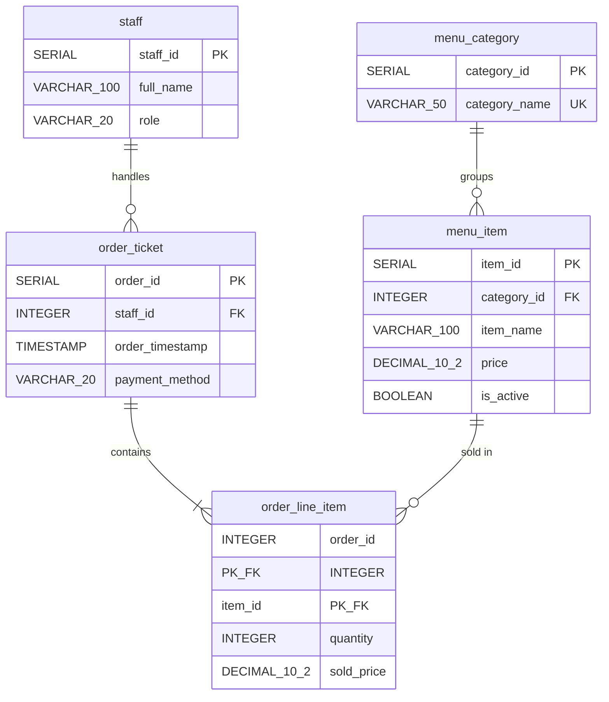

# BrewPOS — Database Documentation

This document explains the PostgreSQL database structure for **BrewPOS**, including the database name, schema, tables, relationships, keys, constraints, and supporting database objects.

---

## 1. Database Summary

| Setting | Value |
|---|---|
| **Database Engine** | PostgreSQL (target `18.6`, compatible with `16+`) |
| **Database Name** | `grp_brewposdb` |
| **Schema** | `public` |
| **Number of Tables** | **5** (`staff`, `menu_category`, `menu_item`, `order_ticket`, `order_line_item`) |
| **Price Data Type** | `DECIMAL(10,2)` — stores exact currency amounts with 2 decimal places |
| **Timestamp Type** | `TIMESTAMP` (without time zone) — stores local café date and time |

### Key Database Design Rule: Calculated Totals
BrewPOS **does not store** line subtotals or order totals in the database.
- When an order is placed, the current `menu_item.price` is copied into `order_line_item.sold_price`.
- Whenever an order receipt or daily sales report is viewed, PostgreSQL calculates the total using `SUM(quantity * sold_price)`.
- Because `sold_price` is saved at checkout, updating an item's menu price later never changes past order totals.

---

## 2. Entity-Relationship Diagram (ERD)

### How the Tables Connect (Relationships)

| Relationship | From (Parent) | To (Child) | Type | Delete Rule |
|---|---|---|---|---|
| **Category -> Items** | `menu_category` | `menu_item` | One-to-Many (`1:N`) | **Restricted:** A category cannot be deleted while menu items belong to it. |
| **Staff -> Orders** | `staff` | `order_ticket` | One-to-Many (`1:N`) | **Restricted:** A staff member cannot be deleted if they have recorded orders. |
| **Order -> Line Items** | `order_ticket` | `order_line_item` | One-to-Many (`1:N`) | **Restricted:** Completed orders and their lines cannot be cascade-deleted. |
| **Menu Item -> Line Items** | `menu_item` | `order_line_item` | One-to-Many (`1:N`) | **Restricted:** Items sold in past orders cannot be deleted (they are marked `is_active = FALSE` instead). |

---

## 3. Tables & Columns

### 3.1 `public.staff`
Stores café employees (`Cashier` and `Manager`).

| Column | Type | Required | Default | Description |
|---|---|---|---|---|
| `staff_id` | `SERIAL` (`INTEGER`) | Yes | Auto-increment | Primary key. |
| `full_name` | `VARCHAR(100)` | Yes | — | Staff member's full name. |
| `role` | `VARCHAR(20)` | Yes | — | Must be `'CASHIER'` or `'MANAGER'`. |

---

### 3.2 `public.menu_category`
Stores menu sections such as `Coffee`, `Non-Coffee`, and `Pastries`.

| Column | Type | Required | Default | Description |
|---|---|---|---|---|
| `category_id` | `SERIAL` (`INTEGER`) | Yes | Auto-increment | Primary key. |
| `category_name` | `VARCHAR(50)` | Yes | — | Unique category name. |

---

### 3.3 `public.menu_item`
Stores all café products, their current selling price, and whether they appear on the Register.

| Column | Type | Required | Default | Description |
|---|---|---|---|---|
| `item_id` | `SERIAL` (`INTEGER`) | Yes | Auto-increment | Primary key. |
| `category_id` | `INTEGER` | Yes | — | Foreign key to `menu_category(category_id)`. |
| `item_name` | `VARCHAR(100)` | Yes | — | Item name (unique inside each category). |
| `price` | `DECIMAL(10,2)` | Yes | — | Current menu price (`0.00` or higher). |
| `is_active` | `BOOLEAN` | Yes | `TRUE` | `TRUE` = shown on Register; `FALSE` = hidden from Register. |

---

### 3.4 `public.order_ticket`
Stores the main receipt header for each completed sale (named `order_ticket` because `ORDER` is a reserved SQL word).

| Column | Type | Required | Default | Description |
|---|---|---|---|---|
| `order_id` | `SERIAL` (`INTEGER`) | Yes | Auto-increment | Primary key (receipt number). |
| `staff_id` | `INTEGER` | Yes | — | Foreign key to `staff(staff_id)`. |
| `order_timestamp` | `TIMESTAMP` | Yes | `CURRENT_TIMESTAMP` | Date and time when the order was saved. |
| `payment_method` | `VARCHAR(20)` | Yes | — | Must be `'CASH'` or `'ONLINE'`. |

---

### 3.5 `public.order_line_item`
Stores each product bought inside an order. It uses a **composite primary key `(order_id, item_id)`**, meaning the same item appears once per order with its combined `quantity`.

| Column | Type | Required | Default | Description |
|---|---|---|---|---|
| `order_id` | `INTEGER` | Yes | — | Part of composite PK; foreign key to `order_ticket(order_id)`. |
| `item_id` | `INTEGER` | Yes | — | Part of composite PK; foreign key to `menu_item(item_id)`. |
| `quantity` | `INTEGER` | Yes | — | Quantity ordered (must be greater than `0`). |
| `sold_price` | `DECIMAL(10,2)` | Yes | — | Unit price captured at the moment of sale (`0.00` or higher). |

---

## 4. Keys & Constraints

| Table | Constraint Name | Type | Rule |
|---|---|---|---|
| `staff` | `staff_pkey` | `PRIMARY KEY` | `(staff_id)` |
| `staff` | `chk_staff_role` | `CHECK` | `role IN ('CASHIER', 'MANAGER')` |
| `menu_category` | `menu_category_pkey` | `PRIMARY KEY` | `(category_id)` |
| `menu_category` | `uq_menu_category_name` | `UNIQUE` | `(category_name)` — prevents duplicate category names |
| `menu_item` | `menu_item_pkey` | `PRIMARY KEY` | `(item_id)` |
| `menu_item` | `fk_menu_item_category` | `FOREIGN KEY` | `category_id -> menu_category(category_id)` |
| `menu_item` | `chk_menu_item_price` | `CHECK` | `price >= 0` |
| `menu_item` | `uq_menu_item_category_name` | `UNIQUE` | `(category_id, item_name)` — prevents duplicate item names in the same category |
| `order_ticket` | `order_ticket_pkey` | `PRIMARY KEY` | `(order_id)` |
| `order_ticket` | `fk_order_ticket_staff` | `FOREIGN KEY` | `staff_id -> staff(staff_id)` |
| `order_ticket` | `chk_order_ticket_payment` | `CHECK` | `payment_method IN ('CASH', 'ONLINE')` |
| `order_line_item` | `pk_order_line_item` | `PRIMARY KEY` | `(order_id, item_id)` *(Composite Primary Key)* |
| `order_line_item` | `fk_order_line_order` | `FOREIGN KEY` | `order_id -> order_ticket(order_id)` |
| `order_line_item` | `fk_order_line_item` | `FOREIGN KEY` | `item_id -> menu_item(item_id)` |
| `order_line_item` | `chk_order_line_quantity` | `CHECK` | `quantity > 0` |
| `order_line_item` | `chk_order_line_sold_price` | `CHECK` | `sold_price >= 0` |

---

## 5. Relevant Database Objects

### 5.1 Auto-Increment Sequences
PostgreSQL creates 4 sequences for the `SERIAL` primary keys:
- `staff_staff_id_seq`
- `menu_category_category_id_seq`
- `menu_item_item_id_seq`
- `order_ticket_order_id_seq`
*(Note: `order_line_item` does not use a sequence because its primary key is `(order_id, item_id)`.)*

### 5.2 Indexes
In addition to automatic primary-key and `UNIQUE` indexes, [schema.sql](schema.sql) creates two performance indexes:
1. **`idx_order_ticket_timestamp`** on `order_ticket(order_timestamp)` — speeds up date filtering on **Orders** and **Daily Sales**.
2. **`idx_order_line_item_item_id`** on `order_line_item(item_id)` — speeds up checking whether a menu item has been used in past orders.

### 5.3 Least-Privilege Application Role (`brewpos_app`)
[05_create_app_role.sql](05_create_app_role.sql) creates an optional non-superuser database login (`brewpos_app`) with only the permissions the app actually needs:
- **`staff`:** `SELECT` only (read-only)
- **`menu_category` & `menu_item`:** `SELECT, INSERT, UPDATE, DELETE`
- **`order_ticket` & `order_line_item`:** `SELECT, INSERT` only *(no `UPDATE` or `DELETE`, keeping completed sales history tamper-proof)*
